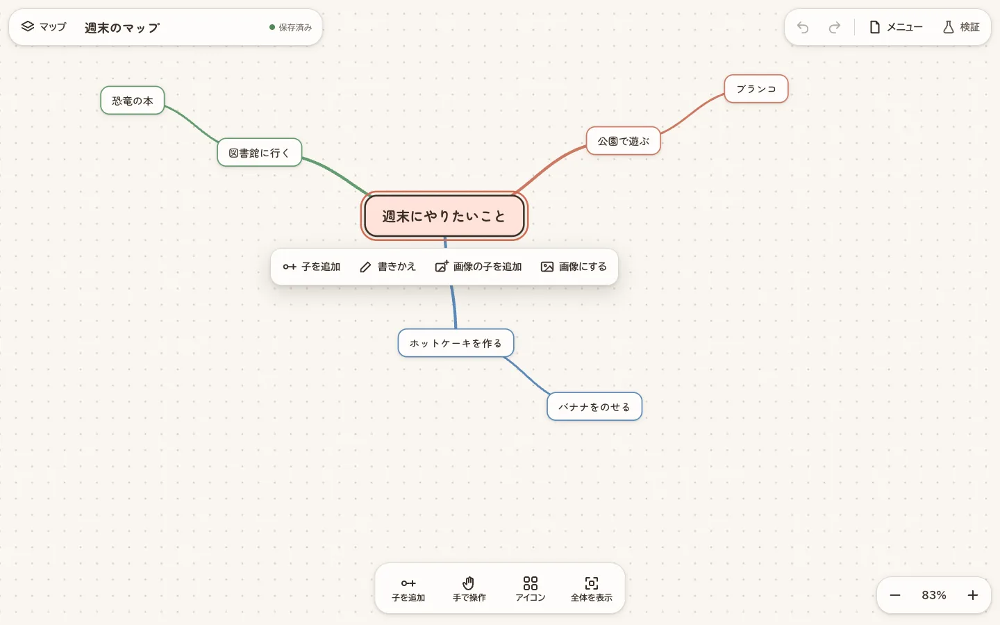

# Mind Map Prototype

English | [日本語](README.ja.md)

A mind map app with editable nodes, images and icons, Japanese voice input, and camera-based hand gestures. Multiple maps and Undo/Redo history are saved in your browser.

## Live links

- [Production app](https://mindmap.luckpoint.jp/)
- [Landing page](https://mindmap.luckpoint.jp/landing)

## Getting started

Use Node.js 22 or later.

```sh
npm install
npm run setup
npm start
```

Open `http://127.0.0.1:8787` in your browser. To use a different port, run `PORT=8790 npm start`.

For detailed setup instructions, including downloading assets for hand gestures, see the [local development guide](docs/guides/local-development.md) and [gesture validation guide](docs/guides/gesture-validation.md) (in Japanese).

## Instructions with Codex

Instruction input is disabled by default. Enabling it requires Codex CLI 0.163.0 and a signed-in session.

```sh
codex --version
codex login
ENABLE_CODEX_INSTRUCTIONS=true npm start
```

Instruction input is disabled when served statically. See the [local development guide](docs/guides/local-development.md) for connection details and limitations.

## Validation

```sh
npm test
npm run build:static
npm run verify:assets
```

Tests mock Codex and do not make billable generation requests. HTTP tests require a local listening socket. See the [deployment guide](docs/guides/cloudflare-workers-deployment-design.md) for the preparation required before validating assets.

## Static deployment

`npm run build:static` prepares vendor and MediaPipe assets, then generates `dist/`. HTML and inline JS/CSS are minified with `@minify-html/node`; external JS/CSS use esbuild. Third-party assets retain their original bytes.

After asset preparation, `npm run dev:cf` previews the minified build. `npm run deploy:staging` and `npm run deploy:production` each rebuild and validate `dist/` before uploading. `npm run build:deploy` rebuilds using existing local assets without downloading MediaPipe again. Source files in `ui-prototype/` remain the local development input.

## Documentation

Design documents, implementation plans, investigations, and validation procedures are listed in the [documentation index](docs/README.md) (in Japanese).

Maps and images are stored in your browser and are lost if you clear its data. Keep JSON exports that include images as backups. For items awaiting validation, including real microphone input, Safari, and iPad behavior, see the relevant design documents and validation records.

## License

Licensed under the [GNU Affero General Public License v3.0 only](LICENSE) (AGPL-3.0-only), including the icon images. If you run a modified version as a network service, you must offer its source code to its users. Third-party components redistributed in the deployed site are listed in [THIRD_PARTY_NOTICES.txt](ui-prototype/THIRD_PARTY_NOTICES.txt).
