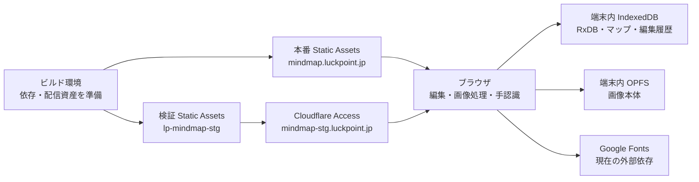

# Cloudflare Workers デプロイ調査・設計

調査日：2026年10月24日。状態：提案。対象：現在の `lp-mindmap`。今回は調査・設計のみで、公開・Cloudflare設定変更・依存追加は行っていない。

## 1. 提案

初期公開は **Workers Static Assets のみ**で構成する。`ui-prototype/` をHTTPSで配信し、マップ・編集履歴は端末のRxDB／IndexedDB、画像はOPFSに保存する。Codex指示入力は既存の `features.js` の `instructions: false` を使う。

Workerの動的スクリプト、D1、R2、KV、Durable Objectsは初期構成には追加しない。端末間同期やクラウドバックアップが必要になった時点で、別途APIと認証を設計する。

本番・検証のURLは以下に固定する。本番は通常公開、検証はCloudflare Accessでログインを要求する。ユーザー指定の「Cloudflare Connect」による保護は、Webアプリの認証を提供するCloudflare Zero Trustの **Cloudflare Access** を指す前提で設計する。Cloudflareアカウント、検証環境の許可ユーザーと認証方式は未確定。

| 環境 | 固定URL | Worker名（案） | 公開範囲 |
|---|---|---|---|
| 本番 | `https://mindmap.luckpoint.jp` | `lp-mindmap` | 通常公開（アプリのログインなし） |
| 検証 | `https://mindmap-stg.luckpoint.jp` | `lp-mindmap-stg` | Cloudflare Accessで許可された利用者のみ |

本番と検証は独立したWorkerとしてデプロイする。検証版の更新が本番へ反映されないよう、Custom Domain・デプロイ先・バージョン履歴を分離する。



アプリを公開しても、既存マップやアップロード画像がCloudflareへ送信・共有される機能は追加されない。別端末で同じURLを開いても、保存済みマップは同期されない。

## 2. 公式情報で確認した仕様

検索結果の古い値やプレビュー版ドキュメントを避け、以下は正規の `developers.cloudflare.com` の本文で確認した。

| 項目 | 調査結果と設計への影響 |
|---|---|
| Static Assets | HTML等を配信でき、動的Workerスクリプトなしでも利用できる。初期構成でNodeサーバーを移植する必要はない |
| 配信料金 | 静的アセットへのリクエストは無料・無制限。アセット保存の追加料金もない。動的Workerを呼ぶ場合は別計算 |
| 配信上限 | Freeは1バージョン20,000ファイル、Paidは100,000ファイル。各ファイル25 MiBまで |
| 動的処理の料金 | Freeは100,000リクエスト/日、CPU 10 ms/呼び出し。Paidはアカウント最低月額US$5、月1,000万リクエスト・3,000万CPU msを含む。超過は100万リクエストあたりUS$0.30、100万CPU msあたりUS$0.02 |
| キャッシュ | 通常の静的レスポンスは `Cache-Control: public, max-age=0, must-revalidate` とETagを持つ。現状の固定ファイル名に適する |
| Gitビルド | Workers Buildsはビルド後にデプロイコマンドを実行できる。Freeは月3,000分、同時実行1件、タイムアウト20分 |
| 設定形式 | 新規プロジェクトは `wrangler.jsonc` が公式推奨 |
| Node互換 | 2026-08-04以降のcompatibility dateではNode互換が既定で有効。ただし `node:child_process` は非機能スタブであり、Codex CLIの起動には使えない |

出典：[Static Assets](https://developers.cloudflare.com/workers/static-assets/)、[静的配信の料金](https://developers.cloudflare.com/workers/static-assets/billing-and-limitations/)、[制限](https://developers.cloudflare.com/workers/platform/limits/)、[Workers料金](https://developers.cloudflare.com/workers/platform/pricing/)、[ヘッダー](https://developers.cloudflare.com/workers/static-assets/headers/)、[Buildsの制限・料金](https://developers.cloudflare.com/workers/ci-cd/builds/limits-and-pricing/)、[Wrangler設定](https://developers.cloudflare.com/workers/wrangler/configuration/)、[Node互換](https://developers.cloudflare.com/workers/runtime-apis/nodejs/)。

この提案の静的配信はFreeで開始できる見込み。独自ドメインの取得・更新費、任意の有料サービス、既存アカウントの契約費は別。動的処理の100,000/日を静的配信の上限と混同しない。

## 3. リポジトリの現状

| 対象 | 確認内容 |
|---|---|
| `package.json` | Node.js 22以上。`setup` がRxDB配信用バンドルを生成。Wrangler依存・deployスクリプトは未導入 |
| `server/index.mjs` | ローカルの静的配信とCodex中継。初期公開には含めない |
| `server/codex-client.mjs` | ローカルCLIを `spawn` する。Workersランタイムへそのまま移せない |
| `ui-prototype/features.js` | 静的配信ではCodex指示入力をOFFにする既存設定 |
| `ui-prototype/storage/` | RxDBのDexieストレージとWeb Locksによる端末内保存・タブ間の編集権管理 |
| `ui-prototype/images/` | 画像のOPFS保存と専用Web Worker |
| `ui-prototype/gestures/` | ブラウザでMediaPipeを実行。推論をCloudflare Worker上で実行する構成ではない |
| `scripts/setup-gesture-assets.py` | MediaPipe 0.10.32と手認識モデルを取得して同一オリジン用に配置 |
| `.gitignore` | `ui-prototype/vendor/` と `ui-prototype/mediapipe/` がGit管理外。クリーンなcheckoutでは存在しない |
| 外部依存 | Google Fonts。RxDBとMediaPipeは同梱後の実行時には外部CDNから取得しない |

手元の配信対象は24ファイル、31,050,927 bytes（約29.6 MiB）。最大は `vision_wasm_internal.wasm` の11,453,626 bytes（約10.9 MiB）。`hand_landmarker.task` は7,819,105 bytes。すべて単一ファイル25 MiB以内で、現在の資産をR2に分離する必要はない。

## 4. 配信・ルーティング

アプリはホストの `/` に配置する。現在は相対URLの参照が多いため、`/mindmap/` のようなサブディレクトリ配信は初期対象にしない。

実装時の `wrangler.jsonc` 案：

```jsonc
{
  "$schema": "./node_modules/wrangler/config-schema.json",
  "name": "lp-mindmap",
  "compatibility_date": "2026-10-24",
  "workers_dev": false,
  "preview_urls": false,
  "assets": {
    "directory": "./ui-prototype",
    "html_handling": "auto-trailing-slash",
    "not_found_handling": "none"
  },
  "env": {
    "production": {
      "name": "lp-mindmap",
      "workers_dev": false,
      "preview_urls": false,
      "routes": [
        { "pattern": "mindmap.luckpoint.jp", "custom_domain": true }
      ]
    },
    "staging": {
      "name": "lp-mindmap-stg",
      "workers_dev": false,
      "preview_urls": false,
      "routes": [
        { "pattern": "mindmap-stg.luckpoint.jp", "custom_domain": true }
      ]
    }
  }
}
```

これは設計例で、実ファイルはまだ作成していない。実装時に採用するWranglerを固定し、設定をその版のスキーマとdry-runで検証する。`main`、`binding`、`run_worker_first` は設定しない。

環境を省略した公開を防ぐため、npmの公開スクリプトは必ず `--env staging` または `--env production` を指定する。検証は `wrangler deploy --env staging`、本番は `wrangler deploy --env production` とする。`workers_dev: false` と `preview_urls: false` は両環境に明示し、環境継承やダッシュボードの設定変更に依存しない。

Custom Domainsを使用する前提として、`luckpoint.jp` のゾーンが対象Cloudflareアカウントで有効であること、既存DNSレコードとの競合がないことを公開作業時に確認する。Accessアプリケーションと許可ポリシーはWranglerの上記設定とは別に構成する。[Custom Domainsと公開URL設定](https://developers.cloudflare.com/workers/wrangler/configuration/)

| リクエスト | 期待する結果 |
|---|---|
| `/` | `index.html` を200で配信 |
| `/index.html` | 標準HTML正規化により `/` へ誘導 |
| `/features.js` | `instructions: false` の静的JS |
| `/vendor/rxdb.js` | 生成済みESM、適切なJS MIME |
| `/gestures/hand-worker.js`、`/images/opfs-worker.js` | Web Worker用JSとして配信 |
| `/mediapipe/wasm/*.wasm` | `application/wasm` で配信 |
| `/mediapipe/hand_landmarker.task` | バイナリをそのまま取得可能 |
| `/api/codex/status`、`/api/instructions` 以下 | APIは存在せず404。HTMLを200で返さない |
| 存在しない `.js`、`.wasm`、任意のパス | 404 |

この表は、本番または検証でAccess認証済みの場合の配信結果を示す。検証への未認証リクエストはAccessのログイン画面への誘導または拒否が先に適用され、静的ファイルを取得できない。

現状はURLパスで画面を切り替えるルーターを持たないため、SPAフォールバックは不要。欠落した資産やAPIをトップページで隠さない。静的構成の404本文はローカル中継のJSONエラー本文と同一であることを要求しない。POST等の非GET/HEADメソッドの応答はWrangler環境で確認し、APIとして成功しないことを検証する。

出典：[ルーティング](https://developers.cloudflare.com/workers/static-assets/)、[アセット設定](https://developers.cloudflare.com/workers/static-assets/binding/)、[HTML処理](https://developers.cloudflare.com/workers/static-assets/routing/advanced/html-handling/)。

## 5. ビルドと公開フロー

初回はローカルで生成・検証し、Wranglerで手動公開する。動作確認後にWorkers BuildsのGit連携を追加する。二つのCIから同じ本番へ自動公開する運用は作らない。

1. Node.jsの採用版とWranglerの採用版を固定する。現状のNode.js 22以上という要件を満たす。
2. `npm ci` でlockfileの依存を復元する。ビルド用のdevDependenciesを省略しない。
3. `npm run setup` で `vendor/rxdb.js` を生成する。
4. `python3 scripts/setup-gesture-assets.py` でMediaPipe資産を取得する。CIのPython 3有無は接続前に確認する。
5. 配信資産検証を実行する。欠落や想定外のバイナリは公開を止める。
6. `npm test` を実行する。既存テストにはlocalhostの待受が必要。
7. `wrangler deploy --dry-run` と `wrangler dev` でCloudflare用設定・HTTP配信を確認する。
8. 公開作業時に `wrangler whoami` でアカウントを確認する。8章のAccessアプリケーションと許可ポリシーを先に構成し、`wrangler deploy --env staging` で検証環境へデプロイする。初回は未認証遮断と迂回経路の無効化を確認してから、許可ユーザーに検証を案内する。
9. `https://mindmap-stg.luckpoint.jp` で受入項目を満たした同じコミット・同じ資産を、`wrangler deploy --env production` で `https://mindmap.luckpoint.jp` へ公開する。

現在のMediaPipe取得スクリプトは取得結果のSHA-256をmanifestに書くが、既知の期待値とは照合していない。実装では期待ハッシュをGit管理の別ファイルに固定し、ダウンロード後に照合する。再ダウンロードで生成されるmanifest自体を信頼の起点にはしない。取得失敗やハッシュ不一致時は公開しない。

追加する資産検証は、少なくともRxDB・MediaPipeの必須ファイル、ハッシュ、各ファイル25 MiB以内、Freeのファイル件数、`features.js` のOFF設定を対象にする。取得途中の `.download`、ソースマップ、OSの管理ファイルを公開対象から除外する `.assetsignore` も用意する。リポジトリのルートを配信先に指定しない。

Workers Builds導入時はプロジェクトルートをリポジトリルートとし、上記の準備・テスト・検証をまとめたビルドコマンドを登録する。デプロイコマンドは固定済みのWranglerと環境の明示指定を使う。本番ブランチと検証ブランチはリポジトリの運用に合わせて確定し、それぞれ別Workerのビルド設定に接続する。初期段階では任意ブランチのプレビュー公開を有効にせず、検証先を固定のstagingに限定する。本番への昇格は検証済みコミットを対象に行い、最新コミットを無条件で公開しない。ビルドログにはマップ内容や認証情報を出さない。

出典：[Builds設定](https://developers.cloudflare.com/workers/ci-cd/builds/configuration/)、[配信除外設定](https://developers.cloudflare.com/workers/static-assets/binding/)。

## 6. 保存データと本番URL

ブラウザの保存領域はオリジンに結び付く。`http://127.0.0.1:8787`、`https://mindmap.luckpoint.jp`、`https://mindmap-stg.luckpoint.jp` は別の保存先になる。HTTPSはOPFS利用の前提だが、ブラウザの対応・容量制限・データ削除まで解決するものではない。[OPFSの仕様](https://developer.mozilla.org/en-US/docs/Web/API/File_System_API/Origin_private_file_system)

実データの移行先は `https://mindmap.luckpoint.jp` に固定する。検証は `https://mindmap-stg.luckpoint.jp` でサンプルデータを使う。同じ利用者が両方へアクセスしても保存内容は共有されない。Accessへのログインは端末間同期やデータバックアップを追加するものではない。

ローカルからの移行は、各マップを画像込みJSONで書き出し、本番URLで読み込む。現在の書き出しは開いているマップだけなので、複数マップは個別に行う。マップ・画像は移せるが、編集履歴や表示設定まで引き継ぐ完全バックアップにはならない。履歴は元のオリジンに残る。本番で復元を確認するまで元データを保持する。

既存の `navigator.storage.persist()` は保存保持を要求するが、許可や永久保持は保証しない。ブラウザデータ削除・プライベートブラウズ・容量不足を考慮し、画像込みJSONの保管を利用案内に含める。Service Workerやオフライン起動は未実装で、静的ホスティングだけでオフライン対応になるわけではない。

## 7. ヘッダーとキャッシュ

実装時に `ui-prototype/_headers` を追加する。

```text
/*
  X-Content-Type-Options: nosniff
  X-Frame-Options: DENY
  Referrer-Policy: no-referrer
  Permissions-Policy: camera=(self), microphone=(), geolocation=()
```

カメラは同一オリジンの画面から利用できるようにする。MIMEの誤りは `nosniff` によって顕在化するため、JS・WASM・モデルの応答を公開前に確認する。

キャッシュは初期段階ではCloudflareの既定値を使う。固定名の `features.js`、RxDB、MediaPipe、アプリJSに長期 `immutable` を設定しない。将来の長期キャッシュはファイル名またはディレクトリのバージョン固定とセットで導入する。

CSPは現状のインラインJS・CSS、Google Fonts、WASM、Blob画像の要件を確認してから導入する。厳しいCSPを推測で適用してアプリを停止させない。COOP/COEPも初期構成では追加せず、実機で必要性が判明した場合に外部フォント等への影響を含めて検証する。

`_headers` は静的レスポンス用であり、将来APIを追加した場合の動的レスポンスにはコード側で必要なヘッダーを付与する。[ヘッダー仕様](https://developers.cloudflare.com/workers/static-assets/headers/)

## 8. 公開範囲と運用

本番の `mindmap.luckpoint.jp` は通常公開とし、アプリ自体にログインは設けない。保存データはブラウザプロファイル内にあり、同じ端末・同じプロファイルを使う人へのアクセス制御は別途必要になる。

検証の `mindmap-stg.luckpoint.jp` はCloudflare AccessのSelf-hostedアプリケーションとして登録し、ホスト全体（全パス）を保護する。今回の案はホスト名単位のAccessであり、本番ドメインは対象に含めない。Static Assetsも保護対象にできるため、認証用の動的Workerスクリプトは追加しない。[WorkersとAccess](https://developers.cloudflare.com/workers/configuration/cloudflare-access/)

| 設定 | 方針 |
|---|---|
| Accessアプリ名 | `mindmap-stg`（案） |
| 対象 | `mindmap-stg.luckpoint.jp` 全パス。HTML・JS・CSS・WASM・モデルを含む |
| Allowポリシー | 明示したメールアドレスまたは既存IdPの検証担当グループだけを許可。未一致は拒否 |
| 認証方式 | 既存IdPがあれば利用。なければメールのワンタイムPINを候補とする。採用方式と許可対象は実装前に確定 |
| セッション | 初期案は8時間。契約・選択した認証方式で設定可能な値を確認して確定 |
| 除外 | 全員許可や静的アセットのBypassポリシーを作らない |
| 別URL | 本番・検証とも `workers.dev` とVersion／Preview URLを無効化。検証Workerに未保護の別Custom Domainを割り当てない |
| 自動検証 | 必要になった場合のみ、専用Service TokenとService Authポリシーを追加。秘密はCI側に保存し、ブラウザ用コードに含めない |

Accessの契約・人数・許可ユーザー・IdPの有無を実装時に確認する。Accessポリシーを先に作成し、検証ドメインが初めて到達可能になる時点から保護する。ダッシュボードやAPIでAccessを構成した場合も、設定値と変更手順を運用記録に残す。[Access公式手順](https://developers.cloudflare.com/cloudflare-one/access-controls/applications/http-apps/self-hosted-public-app/)

セッション失効後、追加のJS・モデル取得が認証画面へ誘導される場合がある。再認証後の再読み込み・カメラ再開を確認する。Accessのログアウトでは、IndexedDB／OPFSの既存データや既に開いた画面は消去されない。Accessはネットワーク経由の取得を制御するものであり、端末に取得済みのデータを遠隔消去するものではない。

初期構成は動的Workerがないため、Workerログでブラウザ内の保存失敗やカメラ失敗を把握することはできない。運用確認は配信エラー、ビルド結果、ブラウザコンソールと実機操作を中心にする。クライアントのエラー収集サービスは初期範囲に含めない。

## 9. 公開前の受入条件

| 分類 | 確認すること |
|---|---|
| 再現性 | 生成物のないクリーンcheckoutから必須資産を作り、検証と既存テストが通る |
| ドメイン分離 | 本番URLと検証URLがそれぞれ別Workerを参照し、検証の更新・ロールバックが本番へ影響しない |
| 検証の認証 | 未認証・許可外ユーザーはHTML・JS・WASM・モデルを直接取得できず、許可ユーザーは利用できる |
| 迂回防止 | `workers.dev`、Version／Preview URL、別Custom Domainから検証資産を未認証で取得できない |
| 認証の継続 | セッション失効・再認証・再読み込み後に保存データを維持し、カメラを再開できる。本番に検証用ログインを要求しない |
| 配信 | `/`、JS、CSS、ESM、Web Worker、WASM、モデルが正しいステータス・MIMEで取得できる |
| 欠落 | 不明パス・不明JS・不明WASM・無効なAPIがHTMLの200にならない |
| 機能フラグ | 指示欄・開閉UIが表示されず、⌘K / Ctrl+Kも無効。通常操作中にCodex APIへ通信しない |
| 保存 | マップ作成・切り替え・削除・再読み込み・Undo/Redo履歴の復元ができる |
| 画像 | 追加・表示・取り外し・Undo/Redo・再読み込み・画像込みJSONの往復ができる |
| タブ | 同じマップの2タブ目は閲覧専用、別マップはそれぞれ編集可能 |
| カメラ | HTTPS上で開始・拒否・停止・再開ができ、画面を操作できる。CPU推論の経路を確認する |
| 対象端末 | MacのChrome／Safariと、iPadのSafariでOPFS・Web Locks・カメラ・画像を確認する |
| 移行 | 別オリジンでは自動共有されず、画像込みJSONで移せることを確認する |
| 更新 | 同じ本番URLで更新しても保存済みマップ・画像・履歴を維持できる |
| 情報の扱い | マップ・画像・映像をサーバーへ送る通信がない。フォント等の静的取得とは区別して調べる |

今回これらのデプロイ受入試験は実施していない。既存テストがあることと、本番のHTTPS／実機で確認できたことを区別する。

## 10. ロールバック

公開時に対象環境、固定URL、コミットID、WorkersのバージョンID、生成資産のハッシュ、固定したツール版を記録する。不具合時は対象環境だけを直前の正常バージョンへ戻す。CLI操作では `--env staging` または `--env production` を明示する。Accessポリシー・DNS／ドメイン設定の復元はコードのロールバックとは別に管理する。[Workersのロールバック](https://developers.cloudflare.com/workers/versions-and-deployments/rollbacks/)

Cloudflareのロールバックで端末のIndexedDBやOPFSは巻き戻らない。ブラウザDBのschemaや保存形式を変更する公開では、旧版が変更後のデータを読めるかを別途確認する。読めない場合は安易に旧版へ戻さず、修正版の前進デプロイを使う。移行前には画像込みJSONを保管する。

## 11. 実装単位と今後の拡張

次の実装は、以下を一つの変更としてまとめる。

1. Wranglerの版固定と `wrangler.jsonc`、ローカル確認・ビルド・デプロイ用npmスクリプト。
2. MediaPipe期待ハッシュ、配信資産検証、`.assetsignore`。
3. `_headers` と配信・404の検証。
4. クリーンビルド、既存テスト、Mac／iPadの受入確認と結果の記録。
5. 本番・検証のCustom Domainと別Workerの設定、検証用Accessアプリケーション、許可ポリシー、迂回防止の確認。対象アカウント・認証方式・許可対象を確定して初回公開する。Git自動公開は初回の受入確認後。

端末間同期が必要になった場合は、認証と所有者チェックを持つWorker API、マップ／同期メタデータ用D1、画像用R2を候補とする。これらは候補であり、RxDBの同期プロトコル・競合解決・削除・割当量・バックアップを別途設計する。共同編集が要件に入った場合のみDurable Objects等を比較する。

Codex機能のクラウド化は別の検討事項。現在のCLIプロセスとローカルログインは通常のWorkersへそのまま載せられない。外部APIへ置き換える案と、認証した別実行基盤でCLIを動かす案を、利用者別認証・料金・データ送信先を含めて比較する。今回の静的公開にローカル中継のインターネット公開は含めない。
