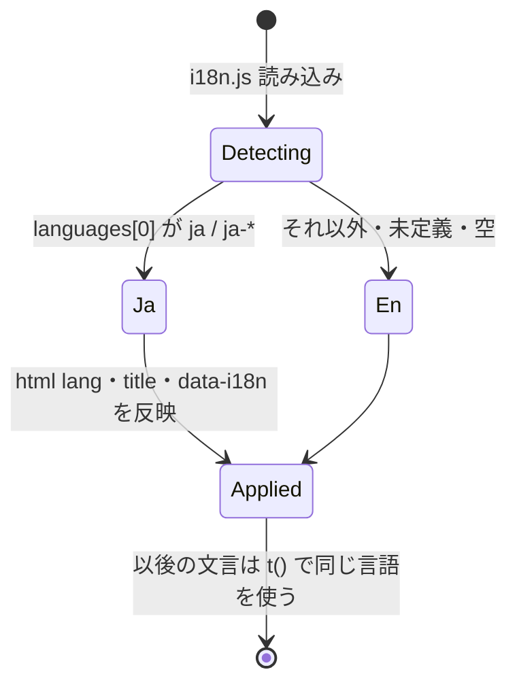

# 多言語化（英語・日本語）設計

2026年10月24日。状態：段階1〜5を実装済み。段階2（中継サーバーとCodex）は後続。

> 実装時の変更：静的HTMLはキーだけを持ち、英語も含めて `apply` で文字を入れる（英語を二重に持たない）。相対時刻は `Intl.RelativeTimeFormat` だとICUにより表記が変わるため辞書の関数にした。開発者向けの `console` 出力とOPFS Workerの内部エラーは英語固定で辞書に入れない。英語の訳は実装時に作成し、対訳表は `i18n.js` の辞書冒頭にある。

## 1. 要件と決定

- 対応言語は **英語（en）と日本語（ja）のみ**。既定は英語。
- ブラウザの第一言語が日本語（`navigator.languages[0]` が `ja` または `ja-*`）のときだけ日本語にする。それ以外（`fr`、`zh`、空、取得不可）はすべて英語。
- 第二言語以降は見ない。`['en-US', 'ja']` は英語。
- 言語は起動時に一度だけ決め、実行中は変えない。言語切替UI・保存・URLパラメータは設けない（要件にないため）。
- ユーザーが入力したマップの内容は翻訳しない。見本マップ・新規マップの初期文字は、作成時の言語で作る（作成後は通常のデータとして保存される）。



## 2. 現状の文言の所在

| 場所 | 量（日本語を含む行） | 表示経路 |
|---|---|---|
| `ui-prototype/index.html` 静的HTML | 約90 | テキスト、`aria-label`、`title`、`placeholder` |
| `ui-prototype/index.html` インラインスクリプト | 約140 | `toast()`、`textContent`、`throw new Error()`、手操作の案内、見本マップ |
| `ui-prototype/{images,instructions,storage,gestures}/*.js` | 約80 | `throw new Error()` → 画面側で `toast(error.message)` |
| `images/opfs-worker.js` | 2 | Worker内のエラー |
| `server/*.mjs` | 約35 | 中継APIのエラーmessage、Codexへの開発者指示 |

日付は `toLocaleString('ja-JP')` / `toLocaleDateString('ja-JP')` に固定されている。

## 3. 仕組み

### 3.1 `ui-prototype/i18n.js`（新規）

既存モジュールと同じUMD形式で、ブラウザでは `globalThis.I18n`、Nodeでは `require` で使う。依存なし。

```js
I18n.detect(languages) // → 'ja' | 'en'（純関数）
I18n.lang              // 起動時に detect(globalThis.navigator?.languages) で決定
I18n.use(lang)         // 言語の固定。テストと Worker 用
I18n.t(key, ...args)   // 文言を返す
I18n.apply(root)       // data-i18n 属性を一括反映
```

- 辞書は `{ en: {...}, ja: {...} }` を同じファイルに持つ。キーはドット区切りで画面の領域ごと（`menu.addChild`、`delete.confirm`、`toast.deleted`、`error.imageTooLarge`、`hand.ready` など）。
- 値は文字列か関数。差し込みや英語の単複を含む文言は関数にする。

  ```js
  en: { 'delete.branchConfirm': n => `Delete ${n} node${n === 1 ? '' : 's'}` }
  ja: { 'delete.branchConfirm': n => `子孫を含む${n}個を削除` }
  ```

  テンプレート記法や複数形ライブラリは入れない。
- 現在の言語にキーがなければ英語、それもなければキー文字列を返す。テストで鍵の過不足を検出するため、本番でこの経路に入ることは想定しない。
- 日付は `I18n.lang` を `toLocaleString` に渡す。「たった今／N分前」は辞書の関数（`time.*`）で返す。

### 3.2 静的HTML

文言を持つ要素に属性でキーを付け、起動直後に `I18n.apply(document)` で置き換える。

```html
<button class="btn" id="newMapBtn"><svg …/><span data-i18n="maps.new">New map</span></button>
<button class="btn btn--icon" id="undo" data-i18n-aria-label="history.undo" data-i18n-title="history.undo" …>
<textarea id="promptInput" data-i18n-placeholder="prompt.placeholder" data-i18n-aria-label="prompt.label" …>
```

- 対応属性は `data-i18n`（textContent）、`data-i18n-aria-label`、`data-i18n-title`、`data-i18n-placeholder` の4つだけ。
- SVGアイコンと文字が同じ要素にあるボタンは、文字を `<span>` で包む（`btn__label` が既にあるものはそれを使う）。
- HTMLには文字を書かず、キーだけを持たせる。`<html lang="en">` を既定とし、`apply` で `document.documentElement.lang` も更新する。`<title>` も `data-i18n` で埋める。
- `i18n.js` はほかのスクリプトより先に同期読み込みし、読み込み時に `apply(document)` を実行する。`<body>` 末尾で実行されるため、初回描画前に文字が入る。
- `innerHTML` で組み立てている `#modeMsg`（`「<b></b>」をどこにつなぐ？`）は、前後の文言を辞書から取り `textContent` で組み立てる。

### 3.3 インラインスクリプトとモジュール

- インラインスクリプトの日本語リテラルは、すべて `t('…')` に置き換える。`const t = I18n.t;` を先頭に置く。
- 手操作の案内（`ready`、`addWaiting` など）は状態名をそのままキーにする（`hand.<state>`）。
- `images/*.js`、`instructions/*.js`、`storage/library.js`、`gestures/camera.js` は、UMDのfactory引数に `I18n` を追加し、`throw new Error(t('error.…'))` にする。エラーコード化はしない（画面側の `toast(error.message)` を変えずに済むため）。
- `opfs-worker.js` のエラーは画面に出ない内部検査（store側が自分の文言に置き換える）のため、英語固定にして `i18n.js` を読み込まない。

### 3.4 ローカル中継とCodex（段階2）

指示機能はローカル中継のみで、Cloudflare公開版では無効（`features.js`）。このため段階2に分ける。

- クライアントは指示の入力に `locale: 'en' | 'ja'` を追加する。`operations.js` の入力検証も更新する。
- サーバーは `createRequire` で同じ `i18n.js` を読み、リクエストの `locale` でエラーmessageを返す。`locale` がない・不正なときは英語。
- `developerInstructions` は言語非依存の英語文にし、「`needs_input` / `no_change` の `message` は `locale` の言語で書く」を加える。指示文そのものはどの言語でも受け付ける。
- 起動時の `console.error` などサーバーログは英語に統一し、辞書に入れない。

### 3.5 見た目

- 英語は日本語より横に長い。ノードメニュー、ドック、削除ダイアログ、手操作の案内で折り返し・はみ出しを確認する。必要なら `btn__label` を狭い幅で隠す既存の仕組みに合わせる。
- フォント（BIZ UDPGothic、Zen Maru Gothic）は英字も含むため変更しない。

## 4. 実装の段階

1. `i18n.js` と単体テスト。辞書は空の雛形から始める。
2. 静的HTMLの属性化と英語化。
3. インラインスクリプトの置き換え。
4. 各モジュール・Workerの置き換え。
5. 画面幅ごとの見た目確認・調整。
6. 段階2：中継サーバーとCodex指示の `locale` 対応。

段階1〜5を一つの機能として出す。途中の状態では英語と日本語が混ざるため、公開しない。

## 5. テスト

### 新規 `tests/i18n.test.cjs`

- `detect`：`['ja-JP']`・`['ja']` → ja。`['en-US', 'ja']`・`['fr']`・`[]`・`undefined` → en。
- 辞書：en と ja のキー集合が一致し、同じキーでは両方とも文字列か両方とも関数である。
- 英語辞書の値（関数は代表的な引数で呼んだ結果）にひらがな・カタカナ・漢字が含まれない。
- `index.html` の `data-i18n*` が参照するキーがすべて辞書にある。
- **退行防止**：`index.html` と `ui-prototype/**/*.js`（`i18n.js` と vendor・mediapipe を除く）に日本語リテラルが残っていない。
- `t()` の差し込み・単複（`n = 1` と `n = 2`）。

### 既存テストの扱い

- `tests/ui-prototype.test.cjs` のvmコンテキストに `navigator: { languages: ['ja'] }` を与え、`i18n.js` を最初に読み込む。既存の日本語の期待値はそのまま通る。
- `require` で各モジュールを読むテストは、先頭で `require('../ui-prototype/i18n.js').use('ja')` する。Node 22 の `navigator.language` は実行環境に依存するため、必ず固定する。
- 英語の代表テストを追加する：`languages: ['en-US']` で見本マップの文字、削除のtoast、`<html lang>` が英語になること。

### 段階2

- `instruction-service`：`locale: 'en'` でエラーmessageが英語、開発者指示に言語指定が入る。`locale` 欠落・不正は英語。

## 6. E2E確認（ローカル・画面操作）

`npm start` でローカルを起動し、Chromeで開く。言語はChromeの起動オプション（`--lang=ja` / `--lang=en-US`）か、DevTools › Sensors › Location の Locale 上書きで切り替え、再読み込みする。

1. **英語環境**：タイトル・ツールバー・ドック・ズームが英語。`<html lang="en">`。
2. 初回起動の見本マップと「New map」の初期ノードが英語。
3. ノードを選び、メニューの各ボタン、`?` のショートカット一覧、削除ダイアログ（子あり・子なし・子孫を含む）の文言が英語で、数の単複が正しい。
4. 削除 → toast「Deleted」と「Undo」で戻せる。
5. マップ一覧の更新時刻表示・相対時刻が英語。
6. 大きすぎる画像やPNGでないファイルをドロップし、エラーtoastが英語。
7. 「手で操作」をオンにし、カメラ許可待ち・認識中の案内が英語。
8. 幅375pxと1280pxで、ノードメニュー・ドック・ダイアログがはみ出さない。
9. **日本語環境**（`ja-JP`）：1〜7が現行と同じ日本語。既存マップの内容は言語に関係なく変わらない。
10. **`['en-US', 'ja']`**（英語が第一）：英語になる。
11. 段階2：`ENABLE_CODEX_INSTRUCTIONS=true npm start` で、英語環境の質問・エラーが英語。

## 7. 決めていないこと

- 段階2（中継とCodex）は後に回す（決定済み）。
- 英語の文言は実装時に訳した（決定済み）。用語の対訳表は `i18n.js` の辞書冒頭にある。
