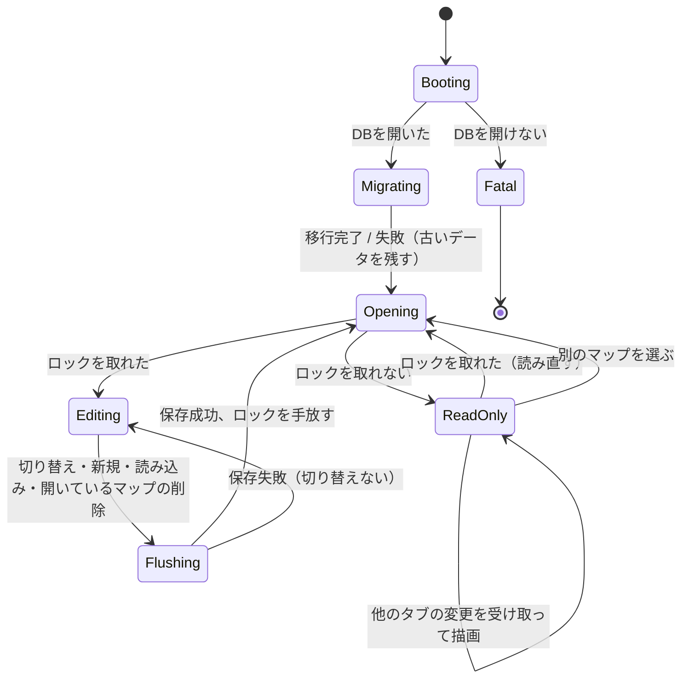
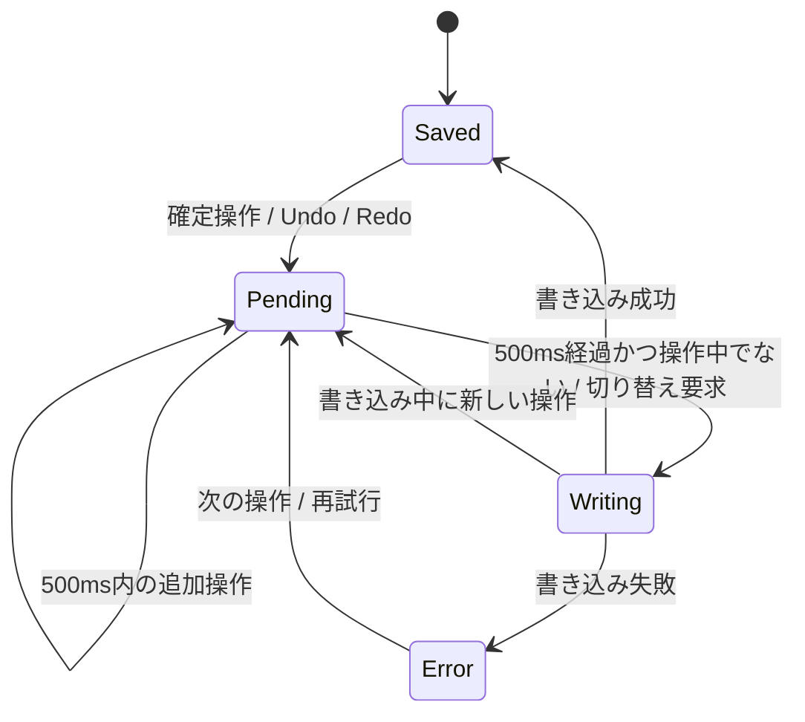
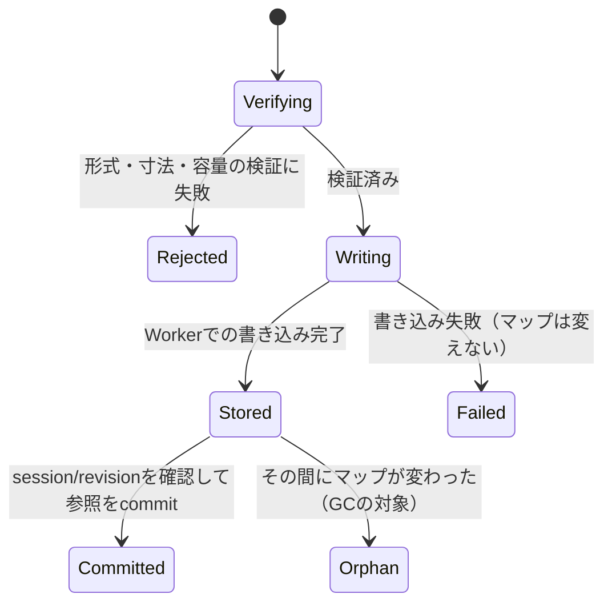

# 複数マップとRxDB＋OPFS保存 設計

2026年10月24日 作成。対象：試作版 `ui-prototype/`。関連：[編集履歴の永続化](edit-history-persistence.md)、[ノードへの画像追加](node-images-design.md)。

## 1. 目的と範囲

- 端末内に複数のマップを持ち、一覧から作成・切り替え・削除できるようにする。
- マップの保存先を localStorage からRxDBへ移す。画像本体の保存先は IndexedDB からOPFSへ移す。
- 将来のHTTP同期（[編集履歴の永続化](edit-history-persistence.md)12章）を、データの形を変えずに追加できるようにする。

範囲外：同期の実装、複数端末での同時編集、マップのフォルダ分け・検索、ゴミ箱。

## 2. 調査で確認したこと

| 項目 | 結果 |
|---|---|
| RxDB最新版 | 17.6.0（2026年10月5日） |
| OPFSストレージ | `rxdb-premium` のみ（Pro、年払いで月99ドルから）。無料の `rxdb` には `storage-opfs` がない |
| 無料のブラウザ用ストレージ | Dexie（IndexedDB）、memory、localstorage、SQLiteのお試し版（約500件まで・インデックスなし） |
| 無料版の制限 | 同時に開けるコレクションは13まで。本設計で使うのは2つ |
| HTTP同期 | 無料の `replication` プラグインの `replicateRxCollection`。どのストレージでも使える |
| 添付ファイルの同期 | 同期のたびに、ドキュメントの添付データをすべて送る（`replication-protocol/index.js`） |
| OPFSへの書き込み | `createSyncAccessHandle()` はWorkerで全主要ブラウザが対応。`createWritable()` はSafari 26から対応で、動作報告が安定しない |

### 決定

- **マップと履歴：RxDB無料版＋Dexieストレージ。** 有料版のOPFSストレージに替えてもアプリのコードは変わらない。
- **画像本体：OPFSに直接、ハッシュ名のファイルとして置く。** RxDBの添付にはしない。添付にすると、ノードの文字を1つ直すだけで画像も同期で送り直すことになるため。画像は内容が変わらず名前で一意に決まるので、同期では「サーバーにないハッシュだけ送る」で済む。
- **書き込みは専用Workerの `createSyncAccessHandle()` で行う。** `createWritable()` の対応差を避けるため。読み込みはメインスレッドの `getFile()` で行う。
- **RxDBはesbuildで1つのESMファイル `ui-prototype/vendor/rxdb.js` にまとめる。** 試作版はビルドなしのまま、`npm run setup` で生成する。mediapipeの資産と同じく、静的配信のときは同梱する。

## 3. 既存設計の見直し

| 既存の記述 | 変更 |
|---|---|
| 試作設計・実装計画「最初の利用単位は一つのローカルマップ」 | 端末内に複数のマップを持つ。端末間の移動は引き続きJSONで行う |
| 編集履歴 3章「P0はlocalStorage、RxDBは入れない」 | 試作版にRxDBを入れる。P0（localStorage）は飛ばし、P1の形で実装する |
| 編集履歴 7章「leader-electionで1タブだけ編集可能」 | RxDBのリーダー選出はデータベース全体で1タブしか選ばない。代わりに**Web Locksでマップごとに編集権を取る**。別のタブで別のマップを同時に編集できる |
| 編集履歴 6章「JSON読み込みで旧マップと旧履歴を削除」 | 読み込みは**新しいマップとして追加**する。今のマップは消さない |
| 画像 6章「画像本体はIndexedDBの専用ストア」 | OPFSへ移す。`Store` のAPI（`put`・`putMany`・`get`・`acquire`・`release`）とasset IDは変えない |
| 画像 6章「GCは複数タブの参照管理ができるまで無効」 | 起動時に、自分以外のタブがない場合だけGCする（8章） |
| 指示 `mapSessionId` | マップの切り替えでも新しくし、待機中の指示を既存の競合処理で終える |

## 4. 構成

```
ui-prototype/
  vendor/rxdb.js         生成物（.gitignore）。createRxDatabase、getRxStorageDexie だけを出す
  storage/library.js     RxDBの初期化、マップの一覧・作成・読み込み・保存・削除、localStorageからの移行
  storage/locks.js       マップごとの編集権（Web Locks）
  storage/history.js     差分履歴の計算・適用・起動時検証（段階3）
  images/store.js        保存先をOPFSに差し替える。APIは同じ
  images/opfs-worker.js  OPFSへの書き込み・削除
scripts/build-vendor.mjs esbuildでvendor/rxdb.jsを作る
```

既存のモジュールと同じUMD形式にして、Nodeのテストから `require` できるようにする。`library.js` はストレージを引数で受け取る（本番はDexie、テストはmemory）。`index.html` は `library` の結果だけを使い、RxDBを直接触らない。

`package.json` に devDependencies として `rxdb`・`rxjs`・`esbuild` を足す（版を固定する）。実行時に外部CDNは使わない。

## 5. データ

### RxDB `mindmap` データベース

**`maps`（schema version 0）**

```js
{
  id: 'm_xxx',          // primaryKey, maxLength 32
  version: 2,           // 既存のマップ形式
  title, root, seq,
  nodes: { ... },       // 既存のnodes。type: object
  cursor: 0,            // 履歴カーソル（段階3まで常に0）
  createdAt, updatedAt, // ミリ秒。updatedAtはindex（一覧の並び）
}
```

- マップ1つを1ドキュメントにする。本体と `cursor` は1回で書く。
- `id`・`cursor`・`createdAt`・`updatedAt` はJSON書き出しに含めない。書き出しは今の `serialize` の形のまま。
- 削除はRxDBの `remove()` を使う。同期のときにも削除として届く。

**`history`**：[編集履歴の永続化](edit-history-persistence.md)4章の形のまま（段階3）。マップを削除したら、そのマップの履歴も消す。

### localStorage（端末ごとの小さな設定）

| キー | 内容 |
|---|---|
| `mindmap:last` | 最後に開いたマップのID |
| `mindmap:view:<id>` | マップごとの表示位置・倍率 |

表示位置はUndoや同期の対象にしない。読めないときは「全体を表示」で開く。

### OPFS

```
/images/<sha256の16進64文字>
```

メタデータ（MIME・寸法）は既存の検証 `verify()` で読むたびに求め、別には持たない。サイズの合計は `getFile().size` から求める。

## 6. 振る舞い

| 操作 | 内容 |
|---|---|
| 起動 | 移行（7章）→ `mindmap:last` のマップを開く。なければ更新が新しい順の先頭、1件もなければ見本マップを作る |
| マップ一覧 | 上部のタイトルの横に「マップ」ボタン。一覧は更新が新しい順で、名前・更新日時・「編集中（別のタブ）」を出す。RxDBの購読で他のタブの変化もすぐ出る |
| 新規作成 | 中心だけの空のマップを作り、開いて中心を編集状態にする |
| 切り替え | 編集・ドラッグ・手の操作・削除確認の最中はできない（「操作を終えてから切り替えてください」）。保存待ちがあれば先に書き込み、成功してから切り替える。失敗したら切り替えずに保存失敗を出す |
| 名前の変更 | 今のタイトル欄のまま。`title` の確定操作として保存する |
| 削除 | 一覧の各行から。確認ダイアログで「元に戻せません。必要なら先に書き出してください」と示す。開いているマップを消したら、残りの先頭を開く。最後の1件を消したら見本マップを作る。別のタブで編集中のマップは消せない |
| JSON読み込み | 検証と画像の保存を終えてから新しいマップとして追加し、それを開く。今のマップは残す |
| JSON書き出し | 開いているマップだけ。今と同じ |
| Undo/Redo | マップごとに保存し、切り替えや再読み込みの後も続けられる。閲覧専用のタブは編集できるようになったときに読み込む。JSONで読み込んだマップは履歴なしで始まる |
| 保存 | 500ms遅延は今のまま。`updatedAt` を更新して `maps` に書く。ドラッグ・手の操作中は書かない |

## 7. 移行

起動時に1回だけ行う。どれも、新しい保存先への書き込みが成功してから古いデータを消す。途中で失敗したら古いデータを残し、次回の起動でやり直す。

1. `maps` が空で、localStorage `mindmap-proto:v1` に正しいマップがある → 新しいIDで `maps` に入れ、成功したらキーを消す。
2. IndexedDB `mindmap-images` がある → 各画像を `verify()` してOPFSへ書き、全部成功したらデータベースを削除する。壊れた画像は移さず、件数をコンソールに出す（表示は既存の「画像を読み込めません」）。
3. `navigator.storage.persist()` を要求する。拒否されても動作は変えない。

## 8. 複数タブ

Web Locksの `mindmap:map:<id>` を、マップを開いている間ずっと持つ。

- `ifAvailable: true` で取れたら編集できる。取れなければ閲覧専用で開き、「別のタブで編集中です」と出す。`maps` のそのドキュメントを購読し、変化したら描画し直す。
- 閲覧専用のタブは、取れるまで待つ（`ifAvailable` なし）要求も出しておく。取れたらDBから読み直して編集できるようにする。
- マップを切り替えるときと `pagehide` で、ロックを手放す。
- 一覧の「編集中（別のタブ）」は `navigator.locks.query()` で調べる。
- 画像のGC：起動時、`mindmap:gc` を `ifAvailable` で取り、`navigator.locks.query()` で他のタブがマップのロックを持っていないときだけ行う。参照は全マップのノードと全履歴のエントリから集める。参照がなく、更新から24時間以上たったファイルだけ消す。

## 9. 状態遷移

アプリ全体：



`Fatal` では「このブラウザでは保存できません」と出し、見本マップをメモリだけで編集・書き出しできるようにする。

保存（開いているマップ1つにつき。画面の保存表示と一致させる）：



画像の保存（1件）：



## 10. 段階

| 段階 | 内容 | 完了条件 |
|---|---|---|
| 1. RxDBと複数マップ | vendorのビルド、`library.js`・`locks.js`、一覧UI、作成・切り替え・削除、読み込みを新規マップに、localStorageからの移行 | 11章のE2E 1〜8（2026年10月24日、ChromiumでE2E 1〜4・6〜8を確認。5は自動テスト。iPad Safariは未確認） |
| 2. 画像のOPFS化 | `store.js` のOPFS化、Worker、IndexedDBからの移行、GC | E2E 9〜11（2026年10月24日、Chromiumで確認。iPad Safariの9は未確認） |
| 3. 履歴の保存 | [編集履歴の永続化](edit-history-persistence.md)の4〜6章を `history.js` と `history` コレクションで実装 | 同書10章のE2E（7・8はマップごとのロックに読み替える）（2026年10月24日、Chromiumで1〜10を確認。上限は1000件） |

段階ごとにコミットし、READMEと関連設計書の記述を更新する。

## 11. テスト

### 自動テスト（`node --test`）

`library.js`（RxDBのmemoryストレージ）：
- 作成・一覧の並び・保存・読み込み・削除。保存したマップが `valid()` を通り、`id` などがJSON書き出しに入らない。
- localStorageからの移行が1回だけ行われ、書き込みが失敗したらキーが残る。
- 2つのDBインスタンスで、一方の保存がもう一方の購読に届く。

`locks.js`（Web Locksの模擬）：
- 同じマップは1つだけが編集でき、もう一方は手放されたら編集できるようになる。別のマップは両方とも編集できる。

`images/store.js`（OPFSとWorkerの模擬）：
- 既存の画像テスト（検証・重複・容量・破損の修復）がOPFS版でも通る。
- IndexedDBからの移行で、全部成功したときだけ古いDBを消す。壊れた画像は移さない。
- GCが、参照されているもの・24時間以内のもの・他のタブがあるときを消さない。

`ui-prototype.test.cjs`（今のvm上の検証を `library` の模擬で拡張）：
- 編集中・ドラッグ中に切り替えを拒む。保存失敗で切り替えない。
- 切り替えで履歴が空になり、待機中の指示が競合で終わる。
- 読み込みで新しいマップが増え、元のマップが残る。読み込みの失敗ではマップが増えない。
- 閲覧専用では、編集・Undo・指示の送信ができない。

### E2E確認手順（ローカル、画面操作）

`npm run setup && npm start` で開き、Chromeで確認する。iPadのSafariでも1〜6と9を確認する。

1. 古い版で作ったマップがある状態で開く → そのマップが一覧に1件だけあり、内容が同じ。
2. 「マップ」→「新しいマップ」→ 中心が編集状態になる。名前を変えてノードを2つ足す。
3. 一覧で元のマップを選ぶ → 元の内容に切り替わり、Undoが無効。一覧は2のマップが先頭。
4. 再読み込みする → 最後に開いた元のマップが、同じ表示位置で開く。
5. 2のマップを開いて表示を動かし、元のマップに戻ってまた2に戻る → 動かした表示位置で開く。
6. JSONを読み込む → マップが1件増えてそれが開き、元のマップは一覧に残る。
7. 別のタブで同じマップを開く → 「別のタブで編集中です」と出て編集できない。元のタブでノードを足すと別のタブにも出る。別のタブで違うマップを開くと編集できる。元のタブを閉じると、別のタブで最初のマップを編集できるようになる。
8. 一覧からマップを削除する → 確認が出て、消すと一覧から消える。開いていたマップを消すと残りの先頭が開く。別のタブで編集中のマップは削除できない。
9. 画像付きのノードがある古い版のデータで開く → 画像がそのまま見える。DevToolsのApplicationで、OPFSの `images/` にファイルがあり、IndexedDBの `mindmap-images` が消えている。
10. 画像付きのマップを削除し、24時間後とみなす設定（検証パネル）で再読み込みする → OPFSから画像ファイルが消える。別のタブを開いたままだと消えない。
11. 画像付きのマップを書き出し、別のブラウザプロファイルで読み込む → 画像も復元される。

## 12. 未決事項

- 削除したマップを一定期間残す（ゴミ箱）か。今回は確認ダイアログだけにする。
- 一覧にマップの縮小表示を出すか。
- 画像の総容量50MiBを、マップごとにするか全体のままにするか。今回は全体のまま。
- 同期を入れるとき、`maps` のどのフィールドを送るか（`cursor` は端末ごとの値なので送らない方向）。
