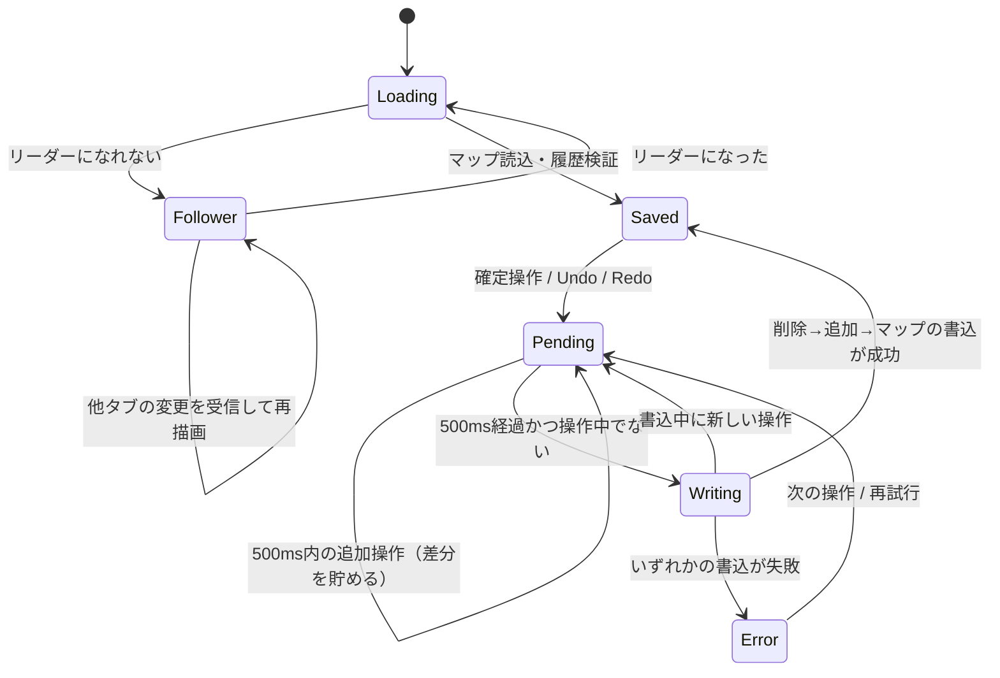
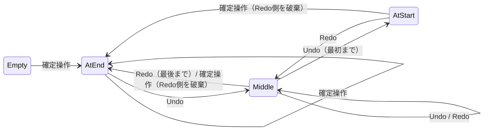

# 編集履歴の永続化 設計

> 2026年10月24日・複数マップ対応：試作版にもRxDB（Dexieストレージ）を入れ、P0は飛ばす。7章の複数タブはマップごとのWeb Locksに、6章のJSON読み込みは新規マップの追加に読み替える。詳細は[複数マップとRxDB＋OPFS保存](./multi-map-storage-design.md)の3章。

> 2026年10月23日・指示入力の設計更新：本書のチャット履歴・`undoSnap`／`undoSeq` に関する記述は、[Codex指示入力の設計](./codex-prompt-design.md)の成功トーストと履歴IDの紐づけに読み替える。会話履歴は持たず、一指示の変更全体を一件の編集履歴にする。保存方式は本書を維持する。

2026年10月22日 作成、10月23日 RxDB採用案・段階分けに改訂。対象：プロトタイプと本実装（B1 履歴、B4 保存）、将来のサーバー保存。

## 1. 現状

| 項目 | 現在の実装 |
|---|---|
| 形式 | 確定操作の直前のマップ全体を `JSON.stringify` した文字列（スナップショット） |
| 置き場所 | メモリ上の配列 `history`（Undo用）と `future`（Redo用）のみ |
| 上限 | 各200件。超えたら古いものから捨てる |
| 保存 | マップ本体だけを localStorage `mindmap-proto:v1` に500ms遅延で保存。履歴は保存しない |
| 消えるとき | 再読み込み、タブを閉じる、JSON読み込み（意図的に初期化） |
| 関連 | チャット欄の「元に戻す」は `history.at(-1) === msg.undoSnap` の文字列比較で最新操作か判定 |

問題：再読み込みでUndoできなくなる。スナップショットを丸ごと保存すると、500ノード×200件で数MBになり localStorage（約5MB）に収まらない。

## 2. 方針

1. **履歴を差分にする**。ノード単位の前後値を持つ。
2. **Undo列とRedo列を一本のリストとカーソルにまとめる**。カーソルより前がUndo、後がRedo。
3. **RxDB（Dexieストレージ）に、マップと履歴を別コレクションで保存する**。
4. **トランザクションに頼らない**。RxDBの原子的な書き込みは1ドキュメント単位だけなので、差分自体に整合確認の材料を持たせ、起動時に検証する（5章）。
5. 呼び出し側の `commit(fn)` は変えない。差分は `commit` の中で前後のマップから計算する。

## 3. RxDBの評価

確認したバージョン：17.4.0（2026年7月）。

| 観点 | RxDB | Dexie単体（前版の案） |
|---|---|---|
| 複数ドキュメントの原子的な書き込み | なし（1ドキュメントのみ） | あり（トランザクション） |
| 複数タブ | 変更が他タブへ自動で届く。リーダー選出あり | 自前（Web Locks・BroadcastChannel） |
| 同期 | CouchDB・GraphQL・HTTP等のレプリケーション、衝突解決の仕組みあり | 自前 |
| スキーマ・移行 | JSON Schema必須、`version`＋`migrationStrategies` | 自前 |
| ストレージ | Dexie（IndexedDBを使う、無料）。素のIndexedDB・OPFSは有料 | — |
| 依存の重さ | RxDB＋RxJS。Dexie単体より大きい | 小さい |

判断：**最終的にサーバー保存を行うため、本実装からRxDBを採る。**
- サーバー保存では、オフライン中の編集・再接続後の送信・衝突の検出が要る。RxDBのレプリケーションがこれを受け持ち、サーバー側はpull／pushの2つのエンドポイントを用意すれば足りる。Dexie単体だと送信キューと衝突処理を自前で作ることになる。
- トランザクションがない分は、5章の書き込み順と起動時検証で補う。この検証はサーバーからの変更受信にもそのまま使える（12章）。
- ストレージは無料のDexieストレージを使う。性能が足りなければ有料のIndexedDB／OPFSに差し替えられる（アプリ側は変えない）。

### 段階

| 段階 | 保存先 | 内容 |
|---|---|---|
| P0 プロトタイプ | localStorage | 差分履歴とカーソルの仕組みだけを先に検証する。ビルドなしの単一ファイルを保つため、RxDBは入れない。データの形は4章と同じにし、マップを `mindmap-proto:v1`、履歴とカーソルを `mindmap-proto:history` に置く。差分なので1000件でも数百KBに収まる |
| P1 本実装 | RxDB（Dexieストレージ） | 4〜8章の設計。サーバーなしで動く |
| P2 サーバー保存 | RxDB＋HTTPレプリケーション | 12章。`maps` だけをサーバーと同期し、`history` は端末内に残す |

P0の起動時検証は5章と同じ処理を使い、P1へそのまま移す。localStorageはP0でも書き込みが同期的なため、マップと履歴の2キーを続けて書く（途中失敗は5章の検証で吸収する）。

## 4. データ

### コレクション `maps`（schema version 0）

```js
{
  id: 'm_xxx',          // primaryKey, maxLength 32
  version: 1,           // 既存のマップ形式
  title, root, seq,
  nodes: { a: { id, text, parent, x, y, order }, ... },  // type: object
  cursor: 42,           // 最後に適用済みの履歴seq。なければ0
}
```

マップは1ドキュメントにまとめ、マップ本体とカーソルを1回の書き込みで原子的に更新する。ノードごとのドキュメントにはしない（今回は分ける利点がない。同期でノード単位の衝突解決が要るときに見直す）。

### コレクション `history`（schema version 0）

```js
{
  id: 'm_xxx|42',       // 複合primaryKey: fields ['mapId', 'seq'], separator '|'
  mapId: 'm_xxx',
  seq: 42,              // マップ内で単調増加。再利用しない
  prev: 41,             // 直前に適用されていたエントリのseq。最初は0
  at: 1761100000000,
  before: { meta: { title: '旧名' }, nodes: { a: {...}, x: null } },
  after:  { meta: { title: '新名' }, nodes: { a: {...}, x: {...} } },
}
```

- `nodes` には変わったノードだけを入れる。`null` は「存在しない」。`meta` は `title`・`seq` のうち変わったもの。
- 差分計算：前後の `nodes` のキーを合わせて走査し、`JSON.stringify` が違うものを拾う。O(ノード数)。
- Undoは `before`、Redoは `after` をマップへ上書きする（`null` は削除）。
- 同期を入れても `history` は端末ごとのものとし、レプリケーションの対象にしない。

## 5. 書き込み順と起動時の検証

マップと履歴は同時には書けない。そこで**マップドキュメントを正**とし、履歴は「マップと辻褄が合う範囲だけ使う補助」として扱う。

保存の順序（1回の保存処理の中で直列に行う）：

1. `history` の不要エントリを削除する（Redo破棄・上限超過・空欄確定の取り消し）。
2. `history` に新しいエントリを追加する（`bulkInsert`）。
3. `maps` のドキュメントを書く（ノードと `cursor` を一度に）。

途中で失敗・中断しても、マップは常に前回保存か今回保存のどちらかの完全な状態になる。履歴のずれは起動時に次の検証で切り落とす。

起動時の検証：
- **Undo側**：`cursor` から古い方へ順にたどる。各エントリの `after` が「その時点のマップ」と一致すればそのエントリの `before` を当て、`prev` のエントリへ進む。一致しない、または `prev` のエントリがなければ、そこで止める。
- **Redo側**：`prev === cursor` のエントリから新しい方へ `prev` をたどり、`before` が一致する間だけ残す。候補が複数あれば `seq` の大きい方を使う。
- どちらの鎖にも入らなかったエントリは削除する。
- たどる途中の状態はメモリ上だけで作り、マップドキュメントは書き換えない。
- 例：手順2の後、手順3の前に中断した場合、新エントリは「Redo側の1件目」として残る（`before` が現在のマップと一致するため）。ユーザーはRedoで取り戻せる。

検証は1000件×変更ノード数ぶんの比較で、起動時に数十ms以内の見込み（B4で計測）。

## 6. 振る舞い

| 操作 | メモリ | 保存 |
|---|---|---|
| 確定操作 | カーソルより後を捨て、新エントリを追加、カーソルを進める | 5章の1→2→3 |
| Undo／Redo | 該当エントリを適用し、カーソルを動かす | `maps` だけ書く |
| 新規ノードを空欄で確定 | 直前のエントリを取り消し、リストから除く（Redoに残さない） | 該当エントリを削除、`maps` を書く |
| 上限超過（1000件） | 最古を捨てる | 該当エントリを削除 |
| JSON読み込み | 新しい `mapId`、履歴は空 | 新マップを書いた後、旧マップと旧履歴を削除 |
| 起動 | マップと履歴を読み、5章の検証 | — |

- **保存のまとめ方**：500ms遅延を残す。前回保存以降に「追加・削除したseq」を貯め、保存処理を直列に実行する。
- **ドラッグ・手の操作中**：保存しない。放した時点の確定操作として予約する。
- **書き込みの衝突（409）**：書くタブは1つだけ（7章）なので通常は起きない。起きたら保存失敗として表示し、最新のマップを読み直す。
- **スキーマ検証**：開発時だけRxDBのdev-modeとスキーマ検証を入れる。本番は既存の `valid()` で読み込み時に検証する。
- **チャット欄**：`undoSnap` を `undoSeq` に置き換え、`msg.undoSeq === cursor` で最新操作か判定する。チャット記録は保存しない。
- **localStorageからの移行**：起動時に `mindmap-proto:v1` があり `maps` が空なら、履歴なしで取り込み、キーを消す。

## 7. 複数タブ

`multiInstance: true` と leader-election プラグインを使う。

- `db.waitForLeadership()` が解決したタブだけを編集可能にする。他のタブは `maps` の変更を購読し、閲覧専用で最新の内容を表示する（「別のタブで編集中です」）。
- 編集タブを閉じると別のタブがリーダーになる。そのタブは5章の検証からやり直してから編集可能にする。
- リーダーが重複した場合（`onduplicate`）はページを再読み込みする。
- 複数タブ同時編集は行わない。Undoが別タブの変更を戻してしまうため。

## 8. 状態遷移

保存の状態（画面の保存表示と一致させる）：



履歴カーソル：



## 9. テスト

単体：
- 差分計算と適用：追加・文字変更・移動（配下含む）・つなぎ替え・配下削除・名前変更で、`after` 適用で後状態、`before` 適用で前状態に一致する。
- カーソル：Undo後の確定でRedo側が消える。上限で最古が消える。空欄確定の取り消しがRedoに残らない。
- 起動時の検証：`after` 不一致・`prev` の欠け・`cursor` の指すエントリなしで、該当範囲だけ捨てられ、マップは変わらない。

RxDB統合（メモリストレージ、または fake-indexeddb＋Dexieストレージ）：
- 5章の手順1・2・3それぞれの直後で中断させ、再起動後にマップが完全で、履歴が検証どおりに切り落とされる（手順2の後なら新エントリがRedoに残る）。
- 連続操作をまとめても、書き込み順序が逆転しない。
- 2つのDBインスタンスで、リーダーだけが書け、もう一方に変更が届く。
- localStorageからの移行が一度だけ行われる。

## 10. E2E確認手順（ローカル、画面操作）

1. 開発サーバーでアプリを開く。
2. ノードを3つ追加し、1つを移動、1つの文字を変える。
3. 再読み込みする → 内容が残り、Undoボタンが有効。
4. Undoを3回 → 文字変更・移動・最後の追加が順に戻る。
5. 再読み込みする → Undoした状態のまま、Redoボタンが有効。Redoで移動が戻る。
6. 新しいノードを追加 → Redoボタンが無効になる。
7. 別タブで同じページを開く → 「別のタブで編集中です」と出て編集できない。元のタブでノードを足すと、別タブの表示にも出る。
8. 元のタブを閉じる → 別タブが編集可能になり、Undoで直前の追加が戻る。
9. JSONを読み込む → Undo・Redoが無効になり、再読み込み後も無効のまま。
10. DevToolsで保存失敗を起こす → 「保存できませんでした」が出て、編集とUndoは続けられる。解除後の次の操作で「保存済み」に戻る。

## 11. 未決事項

- **同期をいつやるか**。RxDBを採るかどうかはこれで決まる（3章）。
- 履歴一覧（操作名つき）を見せるか。見せるならエントリに `label` を足す。
- JSON書き出しに履歴を含めるか。今回は含めない。
- 上限を件数でなく容量で決めるか。B1の100／500ノード計測で見直す。
- サーバー保存で、同じマップを複数の端末から同時に編集するか（12章の分岐）。
- サーバー側の構成と認証。P2の着手時に決める。

## 12. サーバー保存（P2の方針）

- RxDBのHTTPレプリケーションを使う。サーバーは pull（チェックポイント以降の変更を返す）と push（変更を受け取り、衝突したらサーバー側の現在値を返す）を実装する。
- 同期するのは `maps` だけ。Undo履歴は端末ごとの操作の記録なので送らない。
- サーバーから変更が届いたら、マップを差し替えたうえで5章の検証を再実行する。届いた変更と食い違う履歴は自然に切り落とされ、他端末の変更をUndoで消すことはない。
- 衝突の扱いは、同時編集をどこまで許すかで決まる。
  - **1人が一度に1端末で編集する**（想定の既定）：マップは1ドキュメントのまま。衝突時はサーバー側を採り、手元の未送信分は「別の端末の変更で上書きされました」と通知してJSON書き出しで退避できるようにする。
  - **複数端末で同時に編集する**：マップをノードごとのドキュメントに分け、ノード単位で新しい方を採る。マップの形とスキーマのversionが変わるため、P2着手前に決める。
- 保存表示に「未送信」「送信済み」を足す。端末内の保存は今まで通り「保存済み」で示す。
