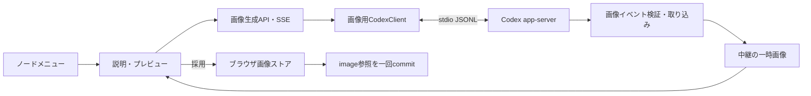

# ノードへの画像追加 設計

2026年10月24日。設計と実装記録。保存・形式・描画の基盤を実装。段階0の接続が管理設定同期に関するRPCエラーで停止するため、生成中継・生成UIは未実装。詳細は末尾の実装状況を参照。

## 1. 目的と初期範囲

ノードの操作メニューに「画像を追加」を設け、Codex app-serverで生成した画像をそのノード内に表示する。文字は残し、画像は文字の上に置く。中心ノードも対象とする。

初期版は1ノード1枚、テキストからの生成・プレビュー・追加・置き換え・取り外し・Undo/Redo・再読み込み・画像込みJSON書き出し／読み込みまでを一つの機能として扱う。ローカル画像のアップロード、画像編集、複数候補の同時生成、画像だけのノード、下部の指示欄からの画像操作は後続とする。

「画像を追加」というメニュー名と、生成前の画面にある「Codexで画像を生成」の説明で入口と手段を示す。生成は明示的な操作で開始し、画面を開いただけでは実行しない。

## 2. 調査で確認したこと

### 現行コード

- `server/codex-client.mjs` はCLI **0.163.0** を固定し、`features.image_generation: false` を指定している。専用の一時cwd、継承MCP・skillsの無効化、予期しないサーバー要求の拒否がある。
- 同じCLIから `codex app-server generate-json-schema --out <tmp>` で生成した `v2/ItemCompletedNotification.json` に `type: "imageGeneration"` がある。既にリポジトリに保存されたSchemaにも含まれる。
- そのitemの必須項目は `id / type / status / result`。`savedPath / revisedPrompt / failure / transparentBackground` は任意。`savedPath` はnullableな絶対パス、`result` は文字列で、Schemaだけでは内容の符号化を確定できない。
- `codex features list` では `image_generation` がstableとして存在する。機能フラグの存在は、ログイン中のアカウントやモデルでの実行成功を保証しない。
- マップはversion 1、ノードは `id / text / parent / x / y / order`。保存はlocalStorage、Undo/Redoはマップ全体のJSONスナップショット各200件。画像ストアはない。
- `renderNode()`、`size()`、辺・当たり判定・手操作はノードのDOM寸法を使う。画像の遅延読込で寸法が変わる構成は避ける。
- `InstructionOperations.serialize()` はマップ全体を複製し、指示APIは1MiBまで。画像本体をマップに埋めると通常の指示送信にも混入する。

### 公式仕様と実接続の限界

[OpenAI公式 app-server資料](https://developers.openai.com/codex/app-server/)は、CLI版に一致するSchemaの生成、thread/turnの開始とイベント処理を説明している。画像イベントの詳細は今回の固定CLIから生成したSchemaを根拠にする。

[Sign in with ChatGPTのpreview制限](https://developers.openai.com/siwc/token-sharing-open-source/preview-limitations)には、この認証・Responses経路で画像生成が未対応とある。現在の既存CLIログインを使う構成と同一視せず、将来認証方式を変更するときに再評価する。

既存クライアントで起動・認証確認を試した結果、サンドボックス内では `CODEX_STOPPED`、通常環境では起動時の `RPC_ERROR` で失敗した。認証確認と画像生成には到達していない。今回、実画像の生成リクエストは行っていない。過去の管理設定同期エラーと同じ原因かは、このエラーコードだけでは断定しない。

**実装の最初に接続検証を置く。** UIを接続できると判断する条件は、実際の設定・認証・モデルで組み込み画像生成が動き、受領した画像を検証・保存できること。APIキーを使う別経路へ自動で切り替えない。

## 3. 画面と操作

```text
ノードメニュー：子を追加 / 書きかえ / 画像を追加 / つなぎ替え / 消す

  「週末の旅行」に画像を追加                      [閉じる]
  Codexで画像を生成
  [ 海辺を走る電車。やわらかい水彩画風。           ]
  ノードの文字と入力した説明をCodexへ送信します。
                                      [生成する]

  生成中：画像を生成しています                  [中止]

  プレビュー：生成画像
                   [説明を直して再生成] [この画像を追加]
```

- 説明欄は対象ノードの文字から初期値を作り、編集可能にする。1〜4000文字。対象ノード名はデータとして別フィールドにも渡す。
- 選択IDはダイアログを開いた時点で固定する。別ノードを選んでも送信先・追加先を変えない。
- 生成結果は自動では追加しない。「この画像を追加」で初めてマップを変更する。未採用プレビューは履歴に入れない。
- 画像付きノードの入口は「画像を変更」。画面に「新しく生成」「画像を取り外す」を用意する。取り外しはノードと文字を残し、一回のUndoで戻せる。
- 置き換え中は旧画像を表示し続ける。生成失敗・中止・ダイアログ取消では旧画像を保持する。
- 再生成は新規request ID・新規thread。自動再試行しない。説明を保持し、再生成が成功するまで直前の候補も保持する。
- ダイアログはフォーカスを閉じ込め、閉じたら起点へ戻す。Escape・閉じるは生成中なら中止も行う。IME確定Enterで生成しない。ボタンはタッチ操作可能な寸法とし、狭い画面ではメニューを折り返す。
- 生成中は固定文言と中止ボタンを出し、推論テキストは表示しない。追加後は「画像を追加しました」と通常の保存状態を別々に示す。
- 手操作で起点ボタンを選べることを確認する。説明欄は標準の文字・音声入力、ダイアログ中のキャンバスの手操作は既存のモーダル方針に合わせて停止する。

## 4. 構成とCodexの実行



通常指示用クライアントは画像無効のままとし、**画像専用の別プロセス**を必要時に起動する。既存 `CodexClient` を実行プロファイル指定可能にし、画像用では `features.image_generation` だけを有効化する。MCP・skills・shell・browser・subagent等の制限は維持する。生成ファイル用の書き込み権限・ディレクトリが必要かは最初の接続検証で確定し、必要なら画像専用の出力領域に限定する。

各生成で新規ephemeral threadを開始し、対象ノードの文字と説明だけを送る。マップ全体・既存画像は送らない。ノード文字列を命令として扱わず、画像を1枚生成するようdeveloper instructionsで指示する。画像用ターンに既存の操作案JSON Schemaは付けない。

`model/list` の既定モデルを候補にするが、画像入力対応を画像生成対応とみなさない。実接続検証でモデルとアカウントによる生成可否を確認する。CLI内部の画像モデル名をアプリから推測して固定しない。

画像は `item/completed` の `imageGeneration` をthread ID・turn IDで対応付け、item IDで重複排除する。早期イベントは既存の指示サービスと同様に一時保留する。成功判定は、対応ターンの正常完了、画像itemの成功、画像の実体検証の三つがそろった時点とする。文章で「生成しました」と返っただけでは成功にしない。生成なし・失敗・複数画像など初期版の契約外の結果は失敗として扱う。

取り込みアダプタは実接続で確認した形式だけを受け付ける。`savedPath` の扱いはrealpath・許可出力領域・通常ファイル・サイズを検証し、任意ファイル読み出しを防ぐ。CLI管理の別出力領域を使う場合は、その領域を実測して明示的な許可先に加える。`result` はbase64と決めつけず、実測した形式に従い検証する。モデルの文章中のパスやURLは取り込まない。絶対パス・認証情報はブラウザへ返さない。

## 5. 実行状態とAPI

```text
editing → submitting → generating → ready → persisting → attached
                         └→ failed / cancelled / conflict
ready → submitting（再生成） / discarded
```

| API案 | 内容 |
|---|---|
| `GET /api/codex/image-status` | 専用プロセス・認証・検証済み対応状態。未検証と利用不可を区別 |
| `POST /api/images/generations` | request ID、client/map session ID、revision、node ID、ノード文字、説明を登録 |
| `GET /api/images/generations/:id/events` | SSE。generating / ready / failed / cancelled |
| `POST /api/images/generations/:id/cancel` | 無効化してturn/interrupt。作成途中の停止にも対応 |
| `GET /api/images/generations/:id/content` | 所有者と有効期限を検証して一時画像を配信 |
| `POST /api/images/generations/:id/release` | 採用・破棄後の一時実体を解放。再送可能 |

一時画像のIDは中継内の不透明なIDとし、ファイルパスをAPIに使わない。contentは限定したラスター画像MIMEのみ、`nosniff` と `no-store` を付けて配信する。現行同様clientSessionIdで所属を検証するが、これはアクセス認証ではない。loopback限定を維持し、公開時の通信保護は既存の後続タスクに合わせる。

通常指示と画像生成でブラウザの実行枠を共有し、同一タブの同時開始を防ぐ。中継にも共通のclient実行枠を設ける。画像のready中も採用・破棄まで枠を保持する。画像生成は中継全体でも同時1件、待ち行列は初期版では持たない。

提案値：RPC 15秒、生成300秒、SSE切断猶予5秒、プレビュー有効期限15分。画像は1枚10MiB・最大4096×4096かつ約16.8M画素以内。接続検証で実際の出力に照らして調整する。期限切れのプレビューを採用させず、説明を残して再生成を案内する。

request IDの重複は同一内容なら同じ実行を返す。キャンセルは先に実行を無効化してから上流を止め、遅延した完了は採用しない。上流interruptは生成処理や利用量の即時停止を保証するものとして説明しない。ページ終了・購読消失・期限切れ・プロセス停止時も一時実体を回収する。

## 6. マップと画像の保存

### ノード参照と画像本体を分ける

```js
// アプリ内のマップversion 2
nodes[id] = {
  id, text, parent, x, y, order,
  image: { assetId: 'sha256:<hex>', alt: '海辺を走る電車の水彩画', width: 1024, height: 1024 }
};
// ブラウザの画像ストア。キーは内容のSHA-256、画像は不変
assets[assetId] = { blob, mime: 'image/png', width: 1024, height: 1024, createdAt: 1792800000000 };
```

画像本体はIndexedDBの専用ストアに置く。初期版ではNode/npm依存を増やさず小さいストアAPIに隔離し、既存のRxDB本実装への移行方針とは分けて扱う。今後移行してもasset IDと参照の形は維持できるようにする。SHA-256は受領バイトからアプリが計算し、モデルには決めさせない。

マップとUndoスナップショットには参照だけを置く。生成プロンプト全文は永続化の必須項目にせず、初期版ではダイアログ内だけに保持する。altはノード名を初期値とする編集可能な説明とし、モデル由来のHTMLを挿入しない。

**保存順序は画像本体 → マップ参照。** ブラウザで実体・デコード・寸法・容量・ハッシュを検証し、IndexedDBの書き込み完了後にsession/revisionを再確認して一回commitする。マップは従来どおり自動保存する。画像保存失敗ならマップを変更せず、候補と説明を保持する。マップ保存失敗なら画像は保持し、既存の保存エラー・再試行・書き出しを利用する。

取り外し・置き換え・ノード削除で画像本体を即削除しない。現在マップ、Undo/Redo、採用処理中の画像を参照集合として扱う。初期版のGCは起動時に行い、復旧対象のマップを読み終えてから、参照されず24時間以上経過した実体だけを回収する。複数タブ間の参照管理ができるまでは自動GCを無効とする。ストレージ圧迫時に参照中の実体を勝手に消さない。

暫定の採用画像総量上限は50MiB。超える場合は既存画像を消さず採用を止め、画像込み書き出しを案内する。ブラウザの容量確保は保証されないため、quotaエラーを必ず扱う。ブラウザデータ消去では画像も失われることは、書き出しの案内に含める。

### バージョンと通常の指示送信

`valid()` をversion 1 / 2に対応させ、version 1を画像なしversion 2へメモリ上で移行する。移行前の保存は初回保存成功まで保持する。未知のversionは拒否する。画像参照の必須項目・型・長さ・asset ID形式・寸法を共有バリデータで検証する。

通常の指示にはversion 2のマップと画像の参照・altまでを送り、Blobやbase64は含めない。操作案の種類は現状のまま。文字変更・つなぎ替えは画像参照を保存し、削除は参照をノードと一緒に消す。新しいノードは画像なし。画像の追加・置き換えは画像用UIだけで行う。送信データが大きい場合の既存1MiB制限も維持する。

## 7. JSONの可搬性

既存の「書き出す」は、画像を含む一つのJSONを返す。マップ参照だけを出して別ブラウザで画像が失われる仕様にはしない。

```js
{
  format: 'mindmap-bundle', version: 1,
  map: { version: 2, title, root, seq, nodes },
  assets: {
    'sha256:<hex>': { mime: 'image/png', width: 1024, height: 1024, data: '<base64>' }
  }
}
```

書き出しは非同期化し、現在のマップを固定して参照画像だけを重複なく格納する。画像なしは従来の単体マップJSONも出力可能にする。画像不足・読込失敗時には不完全なファイルを成功扱いで保存しない。base64の約4/3の増加を考慮し、読込上限は75MiBとする。

読み込みは旧version 1単体、新version 2単体（画像参照なし）、bundleを識別する。外部URL・SVG・HTMLは受け付けない。画像MIME・実バイト・デコード寸法・ハッシュ・参照の過不足・総容量を検証する。画像を書き込んだ後でマップを切り替え、失敗時は現在マップ・保存・履歴を維持する。失敗で残る未参照assetは後日のGC対象とする。参照だけで画像実体のない単体JSONは読み込みを拒否し、画像付きbundleが必要だと案内する。

## 8. 描画・競合・Undo

- 画像領域は幅192px・高さ144pxを基本とし、`object-fit: contain`。読込前から同寸法を確保する。元画像の寸法はメタデータで保持し、表示寸法とは分ける。
- DOMは文字要素と画像要素を分ける。現在の `firstChild` 前提の編集処理を、明示した文字要素への参照に修正する。画像のドラッグ既定動作は無効化する。
- DOM未生成時の `estimate()` も画像領域を考慮する。配置・辺の端点・選択枠・画面に収める・手の当たり判定・メニュー位置に共通の寸法を使う。
- 画像のデコード後に必要な再描画を行い、ノードの座標や他ノードの位置は自動では変えない。大きくなったカードの重なりは手動移動で調整できる。
- Blob URLはストア側でキャッシュし、DOM参照がなくなったら解放する。renderのたびに生成しない。実体が消えた場合は固定枠と「画像を読み込めません」を表示し、文字とマップ編集は維持する。
- 生成開始時のmap session IDとrevisionを固定し、プレビュー表示時と採用直前に検証する。途中の編集・移動・Undo/Redo・インポートは競合として採用を止め、理由と説明文を残す。選択変更・パン・ズームは競合にしない。
- ドラッグ・未確定編集・手による操作の最中は採用しない。対象削除や別マップへの切替後に古い画像を付けない。待機中の通常編集は許可する。
- IndexedDBへのawaitを終えた後、最終検証からcommitまではawaitを挟まない。追加・置き換え・取り外しは各1件のUndo。画像本体は不変で、Undo/Redoは参照を戻すだけ。競合や取消では履歴を増やさない。

## 9. 実装順と完了条件

| 段階 | 作業と完了条件 |
|---|---|
| 0. 実接続の検証 | 起動RPCの失敗箇所を秘密情報なしで特定。画像用の制限プロファイルで1枚生成し、item/status/result/savedPath・出力先・権限・失敗イベントを確認。一般編集側が画像無効のまま動くことも確認 |
| 1. 保存と形式 | 共有version 2検証、v1移行、IndexedDB画像ストア、保存順序、bundle入出力を実装。生成を使わない小画像で再読み込みと他ブラウザへの復元を確認 |
| 2. 描画と直接操作 | 画像枠・寸法・文字編集・辺・手操作・Undo/Redo・取り外しを接続。MacとiPad相当の狭い画面で目視確認 |
| 3. 中継 | 専用Codexプロセス、生成ジョブ、共通実行枠、SSE・中止・一時配信・実体回収を実装。模擬イベントで異常系を検証 |
| 4. UIと統合 | メニュー、入力、生成、プレビュー、採用、置き換え、再生成を接続。実生成から再読み込み・書き出しまで通して確認 |

想定する追加先は `server/image-service.mjs`（ジョブ）、`server/image-output.mjs`（CLI出力取り込み）、`ui-prototype/images/store.js`（実体）、`ui-prototype/images/client.js`（通信）、`ui-prototype/images/format.js`（参照とbundle）。既存 `server/index.mjs`、`codex-client.mjs`、共有operations、`index.html` の描画・履歴・入出力を変更する。生成ジョブのために既存指示サービス全体を継承したり、画像処理を操作案Schemaに詰め込んだりしない。

受入テストでは以下を確認する。

- 追加・置き換え・取り外し・対象削除のUndo/Redoで画像と文字が戻る。再読み込みで画像が残り、bundleを別環境で復元できる。
- 保存失敗、壊れた画像、偽MIME、ハッシュ違い、サイズ／画素／総容量超過、欠損asset、未知versionで現行マップを壊さない。
- 重複POST／item、早期通知、切断・再接続、中止直後の成功、turn開始前の取消、期限切れ、プロセス停止で二重生成・二重採用を防ぐ。
- 生成待ちと画像保存awaitの間の編集・Undo・インポート・対象削除、選択だけの変更をそれぞれ意図どおり扱う。
- 任意パス・シンボリックリンク・他実行の画像を配信しない。通常指示へ画像本体を送らず、既存マップ編集の制限を維持する。
- 画像付きカードの文字編集、辺、ズーム、配置、手のつかみ、メニュー操作を確認。iPadではキーボード・safe-area・ダイアログのスクロールも確認する。

自動テストは模擬Codexと固定の小画像を使う。実生成の受入確認は独立して行い、未実施なら明記する。段階0で組み込み生成が使えなければ、確認できた制約を設計に反映してから生成部分を実装する。

## 10. 実装状況（2026年10月24日）

### 段階0の再検証と実装上の制約

通常環境で通常指示用・画像専用の両プロファイルを起動し、`initialize` は成功したが、次の `config/read` が `-32603` の内部RPCエラーで失敗した。上流のエラー本文は表示・永続化せず、固定キーワードによる分類で管理設定同期に関する記述の存在を確認した。認証確認・モデル照会・画像生成には到達していない。アカウントの画像生成可否や `result` の形式、出力領域は引き続き未確認。

`CodexClient({ profile: 'images' })` は画像フラグだけを有効にする独立クライアントとして用意した。アプリの通常指示は従来の画像無効プロファイルを維持する。RPCエラーにはメソッド名と数値コードだけを付け、上流の本文・dataは保持しない。`node scripts/probe-image-startup.mjs` で同じ起動・認証確認を再実行できる。このスクリプトは画像生成を開始せず、接続に成功しても生成対応を未検証と報告する。

接続が直り、制限プロファイルで実画像の取り込みを検証するまで、段階3・4の生成API・イベントアダプタ・生成ダイアログは接続しない。別認証経路や推測したbase64形式で代替しない。

### 実装した基盤（段階1・2）

- `images/format.js`：ブラウザ・中継共通のv1/v2検証、v1のコピー移行、画像参照、画像付きbundle。未知フィールドへの画像本体混入も拒否する。画像なしはv2単体を出力する。
- `images/store.js`：IndexedDB、不変SHA-256 ID、MIMEシグネチャ・デコード前寸法・実デコード・ハッシュ検証、書き込み完了待ち、重複排除、総容量制限、参照数によるBlob URL管理。自動GCは無効。現在はUndo用・未参照を含むストア全体を50MiBの上限として保守的に扱う。
- 画像本体保存後にsession/revisionを再確認して一回commitする内部採用処理。生成UIは未接続のため通常の画面から新規生成・追加・置き換えは開始できない。画像付きbundleの読み込みは利用できる。
- 中心を含む192×144pxの固定画像枠、読み込み失敗表示、文字要素への明示的参照、既存の辺・当たり判定へのDOM寸法の利用。画像付きノードのメニューで取り外せる。文字変更・削除・取り外し・内部採用のUndo/Redoで画像参照を復元する。
- 非同期の画像込み書き出し／読み込み、75MiBのファイル上限、全画像検証・保存後のマップ切替、読み込み待ち中の編集競合の拒否。不完全な書き出しを成功扱いにしない。

### 検証と残件

Nodeの自動テストでv1/v2、bundleの過不足・MIME・ハッシュ・寸法、10MiBのbase64、画像保存失敗、保存待ちの競合、画像付きDOMでの文字編集、参照のUndo/Redo、URL解放、プロファイル隔離・診断情報の秘匿を確認する。デコード成功のユニットテストではブラウザデコーダーを模擬しており、実画像のデコードやIndexedDBの受入確認の代わりにはしない。

`node scripts/verify-node-images.cjs`（PlaywrightとChromiumを導入済みの環境向け）に、実IndexedDB、固定の小画像、再読み込み、別コンテキストへのbundle復元、文字編集、取り外しのUndo/Redo、欠損画像、768px幅のスクリーンショットの受入スクリプトを用意した。`--chrome` でインストール済みGoogle Chromeを使う。今回の環境ではChromium・Chromeとも起動時にOSの権限制限で停止したため、この受入テスト・画面目視・実機iPad・手操作での画像付きカードの確認は未完了。生成の実行も未実施。

### 継続実装での補強（2026年10月24日）

- 欠損画像のエラー表示中に同じbundleを再読み込みすると、ノードID・asset IDが同じため失敗したDOM・URL参照が再利用されていた。マップ切替時に失敗した参照を解放し、保存済みの画像を読み直すようにした。再読み込みなしの復元をユニットテストで確認し、ブラウザ受入スクリプトにも追加した。
- 内部採用処理は保存開始前に対象ID・session・revisionを値として固定する。呼び出し元が対象オブジェクトを書き換えても追加先は変わらない。手のつかみ状態も保存前・保存後の競合確認と取り外しのガードに加えた。
- 置き換え中の旧画像保持、置き換えの一回のUndo/Redo、保存待機中の手操作、対象オブジェクトの変更、欠損画像の復元を回帰テストに追加した。
- 画像対応のコミット対象だけを取り出した通常環境で `npm test` の全202件が成功し、`git diff --check` と受入スクリプトの構文確認も成功した。
- 通常環境で接続を再検証したが、引き続き `config/read` が `-32603` で失敗した。生成は未実施で、段階3・4の接続条件は未達のまま。Chromiumの受入実行もOSのMachポート登録エラーで起動できず、実ブラウザの確認は未完了。
