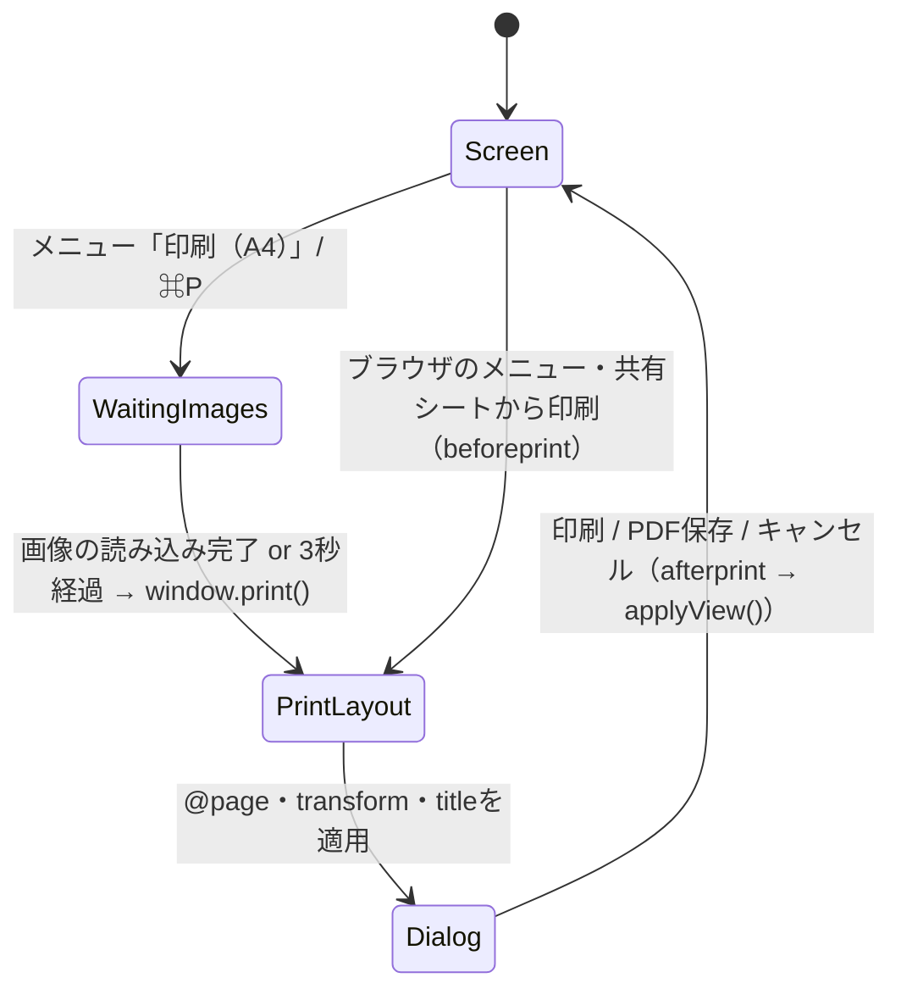

# A4印刷設計

2026年10月24日。設計案。未実装。

## 1. 要件と決定

- 開いているマップ全体を **A4用紙1枚** に収めて印刷する。ブラウザの「PDFに保存」も同じ経路で行う。
- 用紙の向きはマップの縦横比から自動で決める（横長なら横向き、縦長なら縦向き）。
- 余白は10mm。拡大率の上限は画面の「全体表示」と同じ1.25倍で、小さいマップを巨大に引き伸ばさない。下限は設けない。大きいマップは文字が小さくなっても1枚に収める。
- 操作UI（上部バー、ドック、ズーム、カメラ、指示欄、パレット、通知、ノードメニュー、ダイアログ）は印刷しない。方眼の点・影・選択枠・手操作のタグも印刷しない。
- 枝の色とルートの背景色は印刷する。
- マップのデータ・表示位置・Undo履歴は変更しない。閲覧専用のタブでも印刷できる。
- 複数ページへの分割、用紙サイズの選択、印刷範囲の選択は扱わない（要件にないため）。

## 2. 確認した現状

| 対象 | 現状 |
|---|---|
| 描画 | `#viewport` > `#world`（`transform: translate() scale()`）> `#edges`（SVG）と `#nodes`（div）。ノードは全件をDOMに置く |
| 全体の範囲 | `fitAll()` が `size(n)` からノード全体の外接矩形を求め、拡大率を `ZMIN`〜1.25で決める |
| 画像 | `renderNodeImage()` が読み込み中・失敗の文言を `<span>` で重ねる。OPFSから非同期で読む |
| ページ | `html, body { height: 100%; overflow: clip }`。`@media print` はない |
| 配色 | `tokens.css` にダークモードはない |
| メニュー | 「メニュー」（`#fileMenu`）にJSONの書き出し／読み込みがある |
| ⌘P | 未処理。ブラウザ既定の印刷が画面のまま（UIごと、表示中の範囲だけ）出る |

## 3. 仕組み

### 3.1 入口は2つ、処理は `beforeprint` に集約する

- 「メニュー」→「印刷（A4）」と ⌘P / Ctrl+P は `printMap()` を呼ぶ。⌘Pは `preventDefault()` して横取りする。
- `printMap()` は読み込み中の画像を最大3秒待ってから `window.print()` を呼ぶ。
- ブラウザのメニューや共有シートからの印刷は `printMap()` を通らない。そのため配置は `beforeprint` で行い、どの経路でも同じ結果にする（画像は待てない）。
- `afterprint` で元に戻す。

### 3.2 配置の計算（純関数）

`ui-prototype/print.js` を既存モジュールと同じUMD形式で追加し、Nodeのテストから直接呼べるようにする。

```js
PrintLayout.fit(bounds, { margin = 10, maxScale = 1.25 } = {})
// bounds: { x0, y0, x1, y1 }（ワールド座標px）
// → { orientation: 'landscape' | 'portrait', width, height, scale, x, y }
//   width/height は印刷可能域（px）、x/y/scale は #world の transform
```

- A4は210×297mm、CSSの1mmは96/25.4px。余白10mmで印刷可能域は横向き277×190mm（約1047×718px）、縦向きは190×277mm。
- 向きは `(x1 - x0) >= (y1 - y0)` なら横向き。
- `scale = min(width / bw, height / bh, maxScale)`。中央に寄せる `x`, `y` を返す。
- 外接矩形は `fitAll()` の計算を `mapBounds()` に切り出して共有する。`fitAll()` の挙動は変えない。

### 3.3 `beforeprint` / `afterprint`

```js
addEventListener('beforeprint', () => {
  const p = PrintLayout.fit(mapBounds());
  pageStyle.textContent = `@page { size: A4 ${p.orientation}; margin: 10mm }`;
  vp.style.setProperty('--print-w', p.width + 'px');
  vp.style.setProperty('--print-h', p.height + 'px');
  world.style.transform = `translate(${p.x}px, ${p.y}px) scale(${p.scale})`;
  savedTitle = document.title; document.title = map.title || tr('maps.untitled');
});
addEventListener('afterprint', () => { document.title = savedTitle; applyView(); });
```

- `pageStyle` は `<head>` に置く空の `<style id="pageStyle">`。
- `document.title` を変えると、ブラウザのヘッダーと「PDFに保存」の既定ファイル名がマップ名になる。
- `view` は書き換えない。`afterprint` で `applyView()` を呼べば画面の表示に戻る。

### 3.4 印刷用CSS

`index.html` の `<style>` 末尾に追加する。

```css
@media print {
  html, body { height: auto; overflow: visible; background: #fff; }
  body > :not(#viewport) { display: none !important; }
  #viewport {
    position: relative; inset: auto; width: var(--print-w); height: calc(var(--print-h) - 1px);
    overflow: hidden; background: #fff; break-inside: avoid;
  }
  #viewport, .node, .edge { print-color-adjust: exact; -webkit-print-color-adjust: exact; }
  .node { box-shadow: none; outline: none !important; opacity: 1 !important; transition: none; --lift: 1; }
  .node[data-tag]::before, .node__image span { display: none; }
  .edge.is-preview, .edge.is-old { display: none; }
}
```

- 高さを1px減らして、端数で白紙の2ページ目が出るのを防ぐ。
- 読み込みに失敗した画像は枠だけ残る（文言は出さない）。

### 3.5 文言

| キー | en | ja |
|---|---|---|
| `file.print` | Print (A4) | 印刷（A4） |
| `keys.print` | Print the whole map on A4 | マップ全体をA4に印刷 |

キーボード一覧（`#keysDialog`）に ⌘P を追加する。

## 4. 状態遷移



- `WaitingImages` 中に再度 `printMap()` が呼ばれたら無視する（二重のダイアログを防ぐ）。
- 編集中・付け替え中・削除確認中に印刷しても状態は変えない。CSSで枠と半透明を打ち消すため、印刷物には出ない。

## 5. テスト（`npm test`）

`tests/print-layout.test.cjs`（新規）：

- 横長の範囲は横向き、縦長は縦向き、正方形は横向き。
- 結果の矩形 `(x0..x1) * scale + x` が印刷可能域に収まり、中央に寄る。
- 3ノードの小さいマップは `scale` が1.25で止まる。
- 20000px幅の大きいマップも1枚に収まる（`scale` に下限がない）。

`tests/ui-prototype.test.cjs`（追記、既存の模擬DOMを使う）：

- `beforeprint` で `#world` の transform と `pageStyle` が変わり、`view` と保存予定（`storeView`）は変わらない。
- `afterprint` で transform と `document.title` が元に戻る。
- ⌘P は `preventDefault()` され、`window.print` が一度だけ呼ばれる。待機中の2回目は呼ばれない。
- 読み込み中の画像があると `window.print` は画像完了まで待ち、3秒で打ち切る。
- 閲覧専用タブでも印刷でき、マップとUndo履歴が変わらない。
- `i18n.test.cjs` の鍵の過不足検査に新しいキーが含まれる。

## 6. E2E確認（ローカル、画面操作）

`npm start` で `http://127.0.0.1:8787` を開き、Chromeで行う。

1. 見本マップを開き、ズームとパンで一部だけを表示した状態にする。
2. 「メニュー」→「印刷（A4）」を押す。印刷プレビューで次を確認する。
   - 用紙がA4・横向きで、マップ全体が1ページに収まり中央にある。2ページ目がない。
   - 上部バー・ドック・ズーム・方眼の点・影・選択枠がない。枝の色とルートの背景色がある。
3. キャンセルする。画面のズーム・位置・選択が印刷前と同じ。
4. 子ノードを縦に10個以上並べた縦長のマップを作り、⌘Pを押す。縦向きで収まる。
5. アイコンパレットからアイコンを付けたノードを含め、再読み込み直後に⌘Pを押す。画像が「読み込み中」でなく表示されている。
6. 「PDFに保存」を選ぶ。既定のファイル名がマップ名。保存したPDFをプレビューで開き、文字が選択できる（ベクターのまま）。
7. ブラウザの「ファイル」→「印刷」から開いても2と同じ結果になる。
8. 同じマップを別タブで開き（閲覧専用）、印刷できる。
9. 英語環境（`navigator.languages[0]` が `en`）でメニューが「Print (A4)」。
10. Safari（Mac）とiPad Safariの共有→プリントで、3.4のCSSが効くことと用紙の向きを確認する。

Playwrightの `page.pdf({ format: 'A4' })` は `beforeprint` を発火しないため、自動化する場合は `page.emulateMedia({ media: 'print' })` の前に `dispatchEvent(new Event('beforeprint'))` を実行し、ページ数とスクリーンショットで確認する。既存の `scripts/verify-*.cjs` と同じく、Chromiumの起動制限がある環境では手動確認を優先する。

## 7. 未確認事項

- Safariは `@page { size }` の向き指定を無視する可能性がある。無視される場合、用紙の向きはダイアログでの選択に任せ、配置は選ばれた向きに合わないことがある（縮小されて収まるが余白が増える）。
- iPad Safariの共有シートから印刷した場合に `beforeprint` が発火するか。発火しない場合はメニューの「印刷（A4）」を案内する。
- 非常に大きいマップでは文字が読めない大きさになる。目安（`scale` 0.35未満など）で通知を出すかは、実際の印刷物を見て判断する。
