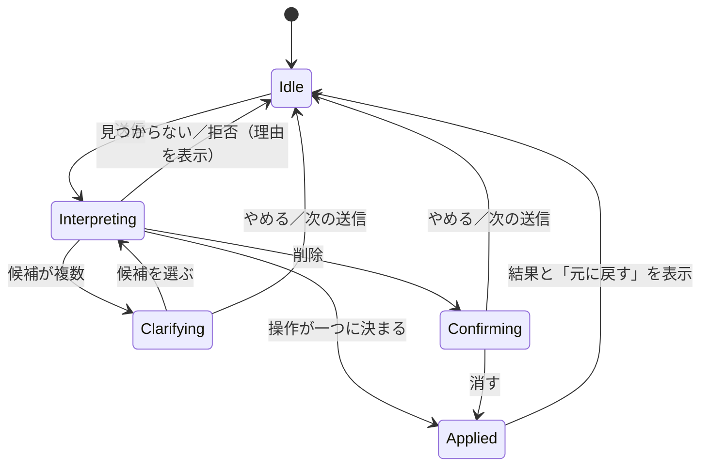
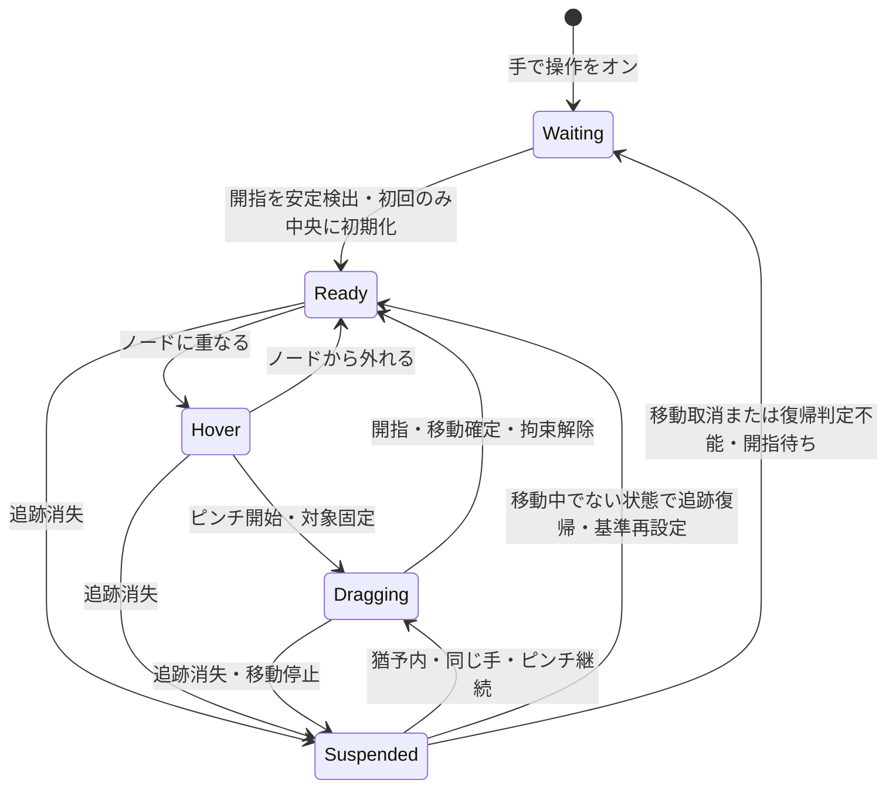

# 声と手で考えを広げるマインドマップ
## プロトタイプの体験設計・開発方針 v0.4

2026年10月22日作成。Shunsukeさんとの対話をもとにした設計提案。

2026年10月22日更新：Web向け技術スタックを採用。初期の音声入力はOS標準のキーボード音声入力を使い、アプリ内の音声認識は実装しない。

2026年10月22日更新（v0.3）：声と文字の入力を、ノード作成だけでなくマップへの指示（追加・書きかえ・つなぎ替え・削除）に使う「チャット欄」を追加する（第6.5節）。声はチャット欄でOS標準の音声入力を使う。指示の解釈にLLMを使い、入力文の外部送信を許容する。

2026年10月22日更新（v0.4）：カメラ操作を「画面中央から始め、人差し指の移動で狙い、ピンチでつかみ、開いて放す」方式として具体化する（第7節）。

本書は、後でCodexに開発を任せる際の判断のよりどころとする。実装コードは含めない。対話で確認された意図と、本書で具体化した提案を区別する。アプリ名は未定。

## 1. 実現したいこと

**思いついたことを声で外に出し、自分の手で動かし、つなぎながら考えを広げられる場所をつくる。**

中心にテーマを置き、関連する考えが放射状に枝分かれする。ユーザーは新しい言葉を追加し、位置を変え、別の枝につなぎ直す。その操作の途中で「これとこれは近い」「これは別の話だった」「ここにもう一つ足したい」と気づけることを目指す。

成果として残るマップに加え、つくる過程そのものに価値を置く。見栄えを整えるための操作より、考えを続けるための操作に時間を使えることが大切である。

身体を動かすことが思考や記憶に役立つのではないか、という期待が出発点にある。ただし学習効果はこのプロトタイプで保証しない。まず「考えが続くか」「自分で関係をつくった感覚があるか」「また使いたくなるか」を観察する。

### 対話で確認された意図

| 意図 | 設計への反映 |
|---|---|
| プラットフォームはWeb | MacとiPadのブラウザで試す |
| 操作の速さが非常に大切 | 入力・移動を推論や通信の完了待ちにしない |
| 中心から放射状に広がるマップ | 中心テーマを一つ持つツリーを基本にする |
| キーボード操作が必要 | 追加・移動・編集・取り消しをキーボードで扱う |
| 音声入力はOS標準のものを使う | 通常のテキスト欄とチャット欄でキーボードの音声入力を利用。アプリ内の音声認識は初期スコープ外 |
| 声・文字をマップへの指示にも使う | チャット欄から「〇〇の子に△△を追加」などで追加・書きかえ・つなぎ替え・削除を行う。チャット欄は開閉できる |
| カメラで手の動きを読み取りたい | ピンチでつかむ・動かす・放す体験を検証する |
| iPadでは直接触れる利点がある | タッチ操作も第一級の入力手段とする |
| 自分と娘たちが使う | 日本語、少ない操作、戻せる安心感を優先する |
| WASMの利用は可能 | MediaPipeのWASMを利用。独自のRust/WASMは性能計測後に必要な処理へ採用する |

第9節の技術スタックとOS標準音声入力の利用は採用方針。その他の具体的な操作、数値、実装順序は提案であり、すべて合意済みという意味ではない。

## 2. 判断が分かれたときに守る優先順位

1. **考えの流れを保つ。** 思いついてから入力するまで、手を動かしてから画面が反応するまでの間を短くする。
2. **ユーザーが関係を決める。** 言葉の位置や親子関係を自分で選べる。AIによる意味の分類や配置は、初期段階では行わない。チャット欄のLLMは、ユーザーがはっきり言った指示を操作に置き換えるだけで、内容の提案や自動分類はしない。
3. **試して戻せる。** 移動、つなぎ替え、削除を取り消せる。間違いを恐れずに触れる。
4. **声と身体の操作を組み合わせる。** 声は内容、手は場所や対象を表す。同時操作を強制せず、交互でも自然につながる。
5. **見た目は読みやすく、穏やかにする。** 文字の重なりや選択状態の分かりにくさは解消する。装飾や凝ったアニメーションの優先度は下げる。

例えば、自動整形で線が整っても、ユーザーが考えながら置いた位置が変わってしまうなら、初期状態では自動整形を働かせない。反対に、入力位置が分からないほど自由度を高めることも避ける。新規ノードには仮の置き場所を用意し、そこから自分で動かせるようにする。

## 3. 最初に成立させたい体験

### 3.1 Mac：話して追加し、手で動かす

1. 中心テーマに「週末にやりたいこと」と入力する。
2. 中心を選び、「子を追加」で子ノードのテキスト欄を開く。
3. OS標準の音声入力を開始して「公園で遊ぶ」と話す。欄に入った文字を確認・修正し、編集を確定する。
4. 手の操作を有効にする。手を認識するとマップ表示領域の中央にポインタが現れ、人差し指の移動に追従する。
5. ノードの上で親指と人差し指をつまみ、好きな場所へ動かし、指を離す。
6. そのノードを選び、子ノードのテキスト欄を開き、同じ方法で「お弁当を持っていく」と入力する。
7. 思いつくままに続け、必要なら一つ前に戻す。

この一連の体験で、OS標準の音声入力から編集・確定へ無理なく進み、「追加した言葉をすぐ自分の手で扱える」ことを確かめる。

### 3.2 iPad：触って選び、話して広げる

中心テーマをタップし、「子を追加」でテキスト欄とソフトウェアキーボードを開く。キーボードのマイクからOS標準の音声入力を使い、文字を確認して編集を確定する。できたノードを指で動かし、別のノードをタップして次の枝を足す。

iPadのカメラジェスチャーは別途試せる体験とする。画面に直接触れる場合との楽しさ、疲れやすさ、設置条件を比較する。直接触れる操作があることを理由に、ジェスチャーの検証を省かない。

### 3.3 キーボード：考えの速度で枝を足す

中心テーマを入力し、Tabで子ノード、Enterで兄弟ノードを追加する。矢印キーで対象を選び、文字を編集する。マイクやカメラを使わない状況でも、一つのマップをつくり続けられる。

## 4. 画面とマップの基本ルール

画面の主役は広いキャンバス。中心テーマは初期表示の中央に、関連ノードは周囲に置く。上部にはマップ名、保存状態、取り消し・やり直し、読み込み・書き出しを置く。下部には「子を追加」「手で操作」「全体を表示」の小さな操作領域を置く。iPadでは指で押しやすい大きさと余白を確保する。

選択中のノード、これからつかめるノード、移動中のノード、親の変更候補は見分けられるようにする。色に加えて枠や短い文言でも示す。常時表示する情報は絞り、手の骨格表示や性能表示は検証用の表示切り替えに置く。

### マップの構造

- 中心テーマは一つ。各ノードは、中心以外、親を一つ持つ。
- 親子関係と表示位置は別に保存する。近くに置いただけでは関係を変えない。
- ノードを動かしている間も、親への線は追従する。
- 親ノードの移動では配下の枝もまとめて動く。中心テーマの移動はマップ全体の平行移動として扱う。
- 新規ノードは親の近くの空いている方向に仮配置する。既存ノードの位置は原則変えない。
- 初期配置は放射状を基本とするが、操作後の位置を円形に戻す拘束は設けない。
- 全体の再配置は、明示的に実行する操作とし、初回スコープには含めない。

画面の拡大縮小や移動は、ノードの世界座標を変更しない。拡大時も縮小時も、同じ場所を指したつもりで選択できることを重視する。

## 5. 入力方法をまたいで一貫させる

### 5.1 共通操作

| 操作 | マウス／タッチ | キーボード | カメラジェスチャー |
|---|---|---|---|
| ノードの選択 | クリック／タップ | 矢印キーで選択移動 | カーソルを重ねてピンチ |
| 子ノードの追加 | 「子を追加」 | Tab | 選択後に画面ボタン、または音声入力と組み合わせる |
| 兄弟ノードの追加 | 選択メニュー | Enter | 初期は専用ジェスチャーを設けない |
| 内容の編集 | ダブルクリック／編集ボタン | F2 | 選択後に通常の編集を使う |
| 位置の変更 | ドラッグ | Alt＋矢印 | ピンチして移動、離して確定 |
| 親の変更 | 「つなぎ替え」モードで移動先を選ぶ | 同モードで選択・確定 | 同モードで移動先をピンチ選択 |
| 削除 | メニューから実行 | Delete／Backspace | 専用ジェスチャーを設けない |
| 取り消し | 常設ボタン | Cmd/Ctrl＋Z | 画面ボタンを使う |

キー割り当ては初期案。ブラウザやOSとの競合を実機で確認する。日本語IMEの変換中や文字編集中は文字入力を優先し、EnterやBackspaceをマップ操作として処理しない。Escで現在の編集・操作をキャンセルする。

矢印キーは、文字編集中以外では画面上の方向に近いノードへ移る。Tabによる子追加はキャンバス操作中とノード編集中に扱い、編集中は現在の編集を確定してから、そのノードの子を追加する。IME変換中は子を追加しない。Escでツールバー等へフォーカスを移せるようにする。

### 5.2 つなぎ替えは意図が見える操作にする

通常のドラッグは位置の変更だけを行う。別ノードの近くで放しただけで親が変わる仕様は採用しない。

親を変えるときは「つなぎ替え」を開始し、移動先候補と接続線をプレビューする。確定するまで元の親子関係は保つ。自分自身や自分の子孫は親に指定できない。中心テーマはつなぎ替えできない。

移動やつなぎ替えは、一回の操作を一回の取り消しで戻せるようにする。ドラッグ途中の座標更新を何十回もの履歴として残さない。

## 6. 音声入力：OS標準の機能を使う

初期版では、アプリに音声認識を実装しない。ユーザーが通常のノード編集欄にフォーカスし、OS標準のキーボード音声入力を使って文字を入力する。iPadではソフトウェアキーボードのマイク、MacではOS側で用意された音声入力の操作を利用する。利用可否と開始方法は対象端末で確認する。

### 追加の流れ

1. 親ノードを選ぶ。未選択の場合は中心テーマを親とする。
2. 「子を追加」またはTabで子ノードを追加し、通常のテキスト欄で編集を開始する。
3. OS標準の音声入力を使い、話した内容を欄へ入力する。
4. 必要に応じて文字を修正し、通常の編集操作で確定する。

追加先はノード追加時に決まる。アプリは認識セッション、途中結果、録音停止や最終結果の到着を管理せず、テキスト欄への入力として扱う。空欄での編集終了は空ノードを残さず取り消す。追加から初回編集の確定までは一つの操作として履歴にまとめ、一回のUndoで追加を戻せるようにする。

### アプリ側で実装する範囲

- 標準のHTML入力要素を使い、日本語IME、OS標準音声入力、手入力で編集できるようにする。
- 文字編集中はEnterで確定し、Tabで確定して子を追加する。フォーカス離脱でも確定する。Backspaceは文字編集として扱い、IME変換中のキーを入力欄へ渡す。
- iPadではキーボード表示時も編集中の欄と確定操作が見えるようにする。
- 音声入力を使えない場合も、そのまま手入力で続けられるようにする。

アプリ内の「声で追加」ボタン、録音、マイク権限要求、Web Speech API、クラウド音声認識、独自の音声下書き・タイムアウト処理は初期版に含めない。音声認識機能自体の失敗からの復帰はOSに委ね、アプリでは欄に入力された文字を通常どおり修正できるようにする。

## 6.5 チャット欄：声と文字でマップに指示する

声や文字は、選んだノードに子を足すだけでなく、マップへの指示にも使う。例えば「図書館に行くの子に『日本の歴史』の本を借りるを追加」と話すと、「図書館に行く」を探してその下に追加する。

### 画面

- 下部の「チャット」で開閉する。開閉状態は端末に覚える。
- 横幅の広い画面（Mac・横向きのiPad）では右のサイドバーとし、キャンバスを縮めてマップを隠さない。
- 狭い画面（縦向きのiPad等）では下からせり上がるシートとし、ソフトウェアキーボード表示中も入力欄が隠れないようにする。
- 上が履歴、下が入力欄。入力欄の上に「選択中：〇〇」を出し、「これ」「ここ」や、指示でない文の追加先が分かるようにする。
- 声は入力欄でOS標準の音声入力を使う。アプリは録音・認識状態を管理しない。

### 扱う指示

| 指示の例 | 操作 |
|---|---|
| 「公園で遊ぶ」（指示の形でない文） | 選択中のノード（未選択なら中心）の子として追加 |
| 「図書館に行くの子に〇〇を追加」 | 指定したノードの子として追加 |
| 「公園で遊ぶを午前中に公園で遊ぶに変えて」 | 書きかえ |
| 「ブランコを図書館に行くの下に移して」 | つなぎ替え（位置の移動は扱わない） |
| 「ブランコを消して」 | 確認してから削除（配下を含む） |

### 解釈と実行

1. 指示の形でない文は、AIを通さずすぐ追加する。考えの速度を落とさない。
2. 決まった言い方はアプリ内のルールで解釈する（試作はここまで）。
3. ルールで解釈できない指示はLLMに送る。マップの木構造と選択中のノードを渡し、追加・書きかえ・つなぎ替え・削除の操作（tool use）だけを返させる。APIキーは中継サーバー側に置く。
4. 対象のノードは完全一致、次に部分一致で探す。候補が複数ならチャット内で選ばせ、見つからなければその旨を返す。
5. 実行した操作は既存の確定操作と同じ経路を通し、一回のUndoで戻せる。履歴に結果と「元に戻す」を出し、変更したノードを選択して表示範囲に入れる。
6. 削除だけは実行前に確認する。自分の子孫へのつなぎ替えや中心の削除・つなぎ替えは拒否する。

## 7. 手の操作：狙う、つかむ、動かす、放す

このプロトタイプでは、カメラ映像をブラウザ内で処理して手の位置を取り出す。毎フレームをLLMに送って操作を解釈させる構成は採用しない。MediaPipe Hand LandmarkerのWeb APIを採用し、得られた座標からアプリ側でピンチ操作を判定する。[S1]

### 7.1 操作の流れ

片手をカメラに向け、人差し指でポインタを動かす。ポインタはアプリ内のマップ操作に使う。OSのマウスポインタを操作する機能は含めない。

| 手順 | ユーザーの操作 | アプリの反応 |
| --- | --- | --- |
| 開始 | 「手で操作」をオンにし、指を開いた片手を映す | カメラの利用許可後、認識を開始する。最初の安定した手の位置を基準とし、マップ表示領域の中央にポインタを出す |
| 狙う | 人差し指を上下左右に動かす | 指先の移動量に応じてポインタが動く。左右は鏡のように対応する |
| 対象を確認する | ポインタをノードに重ねる | ノードの枠を強調し、「つかめる」と表示する。ホバーだけでは選択・移動しない |
| つかむ | ノード上で親指と人差し指をつまむ | 対象を選択し、つかむノードを固定する。「つかみ中」と表示する |
| 動かす | ピンチを保ったまま手を動かす | つかんだノードとその全子孫が同じ量だけ移動する。親子関係は変わらない |
| 放す | 親指と人差し指を開く | 移動を確定し、ノードとの結び付きを解く。ポインタは放した位置から自由に動かせる |

「中央から開始」は手操作セッションの最初だけに適用する。ノードを放すたびに中央へ戻さない。「ポインタも解放」はノードへの拘束を解く意味で、ポインタの非表示やカメラの停止を意味しない。

移動は一回の「つかむ → 放す」を一つの履歴として扱い、一回のUndoで元に戻す。動かさずに放した場合は選択だけとし、移動履歴を追加しない。中心ノードを動かした場合は、全ノードを同じ量だけ動かす。

### 7.2 ポインタの移動とピンチ時の位置合わせ

今回の初期案は、カメラ内の指先位置を画面の絶対位置へ直接割り当てる方式から、指先の移動量を使う方式へ具体化する。画面上の一点に指を向ける角度を測るのではなく、映像内の人差し指先の上下左右の変位を入力にする。

- 最初に安定して認識した人差し指先を基準にし、ポインタをマップ表示領域の中央へ置く。
- 以後の指先の変位を、左右反転と感度調整を通して画面上の移動量へ変換する。微小な震えを平滑化し、小さな動作範囲で操作できる感度を実機で調整する。
- ポインタはマップ表示領域の端で止める。端を越えた入力は蓄積せず、逆方向へ動かすとすぐ戻れるようにする。初期版では端での自動パンを行わない。
- ノードをつかむ直前のポインタとノードの位置関係を保持し、つかむ瞬間にノードを指先やポインタの中心へ吸着させない。
- ピンチ成立時に指先の基準を取り直し、それ以降の変位をドラッグに使う。親指を閉じる動作に伴う指先の位置ずれを、ノードの移動として反映しにくくする。
- 開指が確定したら直前のドラッグ位置で移動を確定し、開いた指先の位置で基準を取り直す。指を開く動作によるポインタとノードの飛びを抑える。
- ドラッグの画面上の変位は、マップのズーム倍率を考慮して世界座標へ変換する。

親指と人差し指の先の中点を常時ポインタに使う従来案は、この操作設計では採用しない。ピンチ中も人差し指先の変位を基本とし、閉じた指の遮蔽や姿勢で不安定になる場合は、実機検証の結果を記録して追跡点を再検討する。

### 7.3 ピンチと操作状態

親指と人差し指の先の距離を手の大きさで正規化してピンチを判定する。閉じる判定と開く判定には異なる閾値を使い、短い認識の揺れでつかむ・放すを繰り返さないようにする。距離の閾値、安定判定時間、感度、平滑化係数は実機で調整する値とする。

- 対象はピンチが始まったときのホバー先に固定する。移動中に別のノードへ切り替えない。
- 空白でピンチしても操作を開始しない。閉じたままノードへ入ってもつかまず、一度開いてから再度ピンチする必要がある。
- つなぎ替えモードではピンチを移動先候補の選択として扱い、通常のドラッグを開始しない。
- テキスト編集中や通常のマウス・タッチ操作中は、手による移動開始を抑止する。通常入力から手操作へ戻る際は基準を取り直し、開指を確認する。
- Esc、手操作の停止、画面離脱、バックグラウンド移行で未確定の移動を取り消す。

### 7.4 手が見えなくなった場合

追跡の消失を「指を開いた」と扱わない。ポインタとノードをその場で止め、「手が見えません」と表示する。

移動中は300ms程度を初期値として猶予を設け、同じ手と判断でき、ピンチが継続している場合だけ再開する。復帰時は指先の基準を取り直し、停止した位置から続ける。別の手か判断できない場合、猶予を超えた場合、再検出時に指が開いている場合は、移動前のノード位置へ戻す。認識消失中の開指による意図しない移動確定を防ぐためである。

取消後は一度開いた手を安定して認識してから次のピンチを受け付ける。同じセッション内の再認識では、ポインタは最後の位置を維持して基準を取り直す。中央への初期化は新しいセッション開始時だけ行う。

### 7.5 表示とカメラの扱い

ポインタ、つかめる対象の枠、つかみ中、追跡消失を区別する。小さなカメラプレビューは位置合わせの補助として表示でき、隠すこともできる。手が映っていない場合は「カメラに手を映してください」と案内する。初回は「人差し指で動かす → ノード上でつまむ → 開いて放す」と短く案内する。

カメラ操作は明示的な開始時だけ有効にする。停止、画面離脱、アプリのバックグラウンド移行時は操作を中断し、カメラを止める。復帰後に自動でカメラやドラッグを再開しない。映像と手の座標はブラウザ内で処理し、保存や外部送信を行わない。OS標準の音声入力の開始・停止はOS側の操作に委ねる。

初期版は片手でのポインタ移動とノードの移動を対象にする。両手操作、空中での文字入力、ジェスチャーによる削除は後続とする。

### 7.6 最初の実機検証と合格条件

最初はMacのカメラと仮ノード一つで検証する。現在の `ui-prototype/index.html` の手操作はマウス入力によるモックであり、実際のカメラ認識が動作することを示すものではない。

- 開始時にポインタがマップ表示領域の中央から動き出す。
- 人差し指を上下左右に動かすと、意図した方向へポインタが動く。
- ノードを狙い、ピンチして移動し、指を開いて放す操作ができる。同じ条件の10回中8回以上を初期目安にする。
- つかむ・放す瞬間に、ノードやポインタが不意に跳ねない。放した後はその位置から次の対象へ狙い直せる。
- 空白で始めたピンチや、閉じたままの再検出でノードをつかまない。
- 追跡消失では停止し、復帰条件を満たさなければ移動を取り消す。一回のUndoで確定した移動を戻せる。
- カメラへ真正面に指差す姿勢、少し斜めの姿勢、近距離・遠距離、照明の違いを試し、関節の重なりや指先の遮蔽による不安定さを記録する。
- 小さな動作範囲と短いセッションで、追従の遅れ、狙いやすさ、腕の疲れを確認する。数値目標の達成だけで快適と判定しない。

iPadの成立条件と結果はMacと分けて記録する。認識品質・性能は実機で未検証であり、この設計は実装方針と検証条件を定めたものである。

## 8. どこまでをプロトタイプとするか

### 完成に必要な範囲

| 領域 | 今回つくる体験 |
|---|---|
| マップ | 中心テーマ、子・兄弟ノード、枝、自由配置、つなぎ替え、削除 |
| 通常入力 | マウス、タッチ、基本ショートカット、日本語編集 |
| 音声入力との併用 | 通常のテキスト欄でOS標準音声入力を使い、修正・確定できる。アプリ内の認識処理は実装しない |
| 手の操作 | 有効化、カーソル、ピンチ移動、追跡消失時の取消 |
| 回復 | Undo/Redo、ローカル自動保存、JSON書き出し・読み込み |
| 表示 | パン、ズーム、全体表示、選択と入力状態の明示 |
| 確認 | Macの基本操作・音声・手の操作、iPadのタッチ・音声の実機評価 |

iPadの手の操作も試すが、最初のジェスチャー完成判定はMacで行う。iPadで未検証・不成立の機能は、そのまま記録し、全環境対応済みとは扱わない。

### 後に回す範囲

ログイン、複数人の同時編集、アカウント間同期、AIによるアイデア生成・要約・自動分類、アプリ内の録音・音声認識・専用の音声入力UI、自由な相互リンク、画像や添付ファイル、テーマ編集、印刷最適化、ネイティブMacアプリは後続とする。最初の利用単位は一つのローカルマップ。端末間の移動はJSONファイルで行う。

開発中は段階的に使える状態をつくるが、キーボードだけのマップで完成とはしない。OS標準音声入力との併用と手の操作を含めて、当初の体験を評価する。

## 9. 技術は体験を支えるために選ぶ

### 採用する技術スタック

| 要素 | 採用方針 | 判断理由 |
|---|---|---|
| 開発基盤 | Vite＋TypeScript | ブラウザ主体のWebアプリとして構成を小さく保つ |
| アプリUI | React | ツールバー、編集欄、入力状態を構成する |
| マップ描画 | HTMLのノード・入力欄＋SVGの枝を自作 | 日本語編集と、独自のドラッグ・ジェスチャー操作を両立する |
| 状態管理 | Zustand＋UIから独立した共通コマンド処理 | 確定データと一時状態を分け、検証・Undo/Redo・保存を一貫して扱う |
| 通常入力 | Pointer Events＋キーボードイベント | マウス・タッチ・ペンを共通化し、文字編集を優先する |
| 手の推論 | MediaPipe Tasks Vision＋専用Workerを基本に実機検証 | 同期推論をUI処理から分離する |
| 音声入力 | OS標準のキーボード音声入力を通常の編集欄・チャット欄で利用 | アプリ内の音声認識は実装しない |
| 指示の解釈 | ルールで解釈できない指示だけLLM（Claudeのtool use）へ送る | 自由な日本語の指示を、既存の確定操作に置き換える |
| 永続化 | IndexedDB＋Dexie、JSON入出力 | ローカル自動保存と形式の更新に対応する |
| 配布 | HTTPSの静的ホスティング＋LLM中継の小さなサーバー（Cloudflare Workers等） | 中継はAPIキーを隠すためだけに置く。LLMが使えなくても通常操作とルール解釈は成立する。配布先は未定 |
| Rust/WASM | 計測後に必要な計算へ追加 | 一括レイアウトや空間探索など、実際のボトルネックに適用する |

React Flowは初期版に採用せず、HTML＋SVGで独自の操作体系を実装する。Next.jsやSSRは初期版に導入しない。各依存のバージョンは実装開始時に固定する。

HTML＋SVGの性能は未検証。描画範囲の制限や更新対象の削減を試し、それでも目標を満たせない場合にCanvas/WebGL等を比較する。手の座標・ドラッグ・パンの頻繁な更新でReactの画面全体を再描画しないようにする。

MediaPipeのWebパッケージ自体がWASM実行資産を利用する。アプリ側のRust/WASMとは別の採用判断となる。公式Web APIで接続できるため、この用途で独自のC++ FFIを最初に構築する必要はない。[S1]

Rust/WASMを採用する場合も、ノード単位・フレーム単位の細かい往復を増やさず、一括した計算要求と結果を受け渡す。入力、描画、推論をすべてRustにまとめることを前提にしない。逆に、技術学習としてRustを使うことを優先したくなった場合は、その目的を明示して範囲を改訂する。

### 内部の責務

入力アダプターが、追加・編集・移動・つなぎ替え等の共通コマンドを発行する。共通コマンド側が、親子関係の検証、Undo履歴、永続化を一貫して扱う。描画はその状態を表示する。OS標準の音声入力で入力された文字も通常のテキスト編集として扱う。手の推論から保存データを直接書き換えない。

永続化する情報は、マップの識別子・形式バージョン・中心ノード、各ノードの識別子・文字列・親・順序・世界座標、必要な表示設定とする。選択中の対象、編集中の文字列、手の座標、ドラッグ中の仮位置は一時状態として分ける。

移動中は仮表示を更新し、放した時点で一つの確定操作にする。読み込み時には形式バージョン、親の存在、循環の有無を検証する。不正なファイルは現在のマップを壊さずに読み込みを中止する。

### 推論と表示を分ける

手の推論は描画のフレーム数と独立して動かし、最新のフレームだけを処理する。処理待ちの映像を積み上げない。手の検出処理は同期呼び出しのため、公式資料でもWorkerの利用が案内されている。[S1]

ただしWorker上の映像受け渡し・実行方式は対象Safariを含めて技術検証する。成立しない端末では推論頻度を下げた構成を計測し、満たせなければ手の操作の対応を保留する。通常入力や保存まで止めない。

## 10. 速さと使いやすさを確かめる基準

以下は達成済みの数値ではなく、初期の評価目標。基準端末はShunsukeさんのMacと実際に使用するiPadとし、機種・OS・ブラウザ版を記録する。

| 評価対象 | 初期目標・観察方法 |
|---|---|
| 代表的なマップ | 100ノード程度で追加・移動を気持ちよく続けられる |
| マウス・タッチの追従 | 入力から表示まで通常50ms以内を目安に計測。大きな停止を記録する |
| 描画 | 操作時60fpsを目標。推論有効時も長い引っかかりを生まない |
| 手の操作 | 15〜30回/秒程度の推論を目安に、カメラ入力から表示まで150ms以内を目標として実測する |
| OS標準音声入力との併用 | テキスト欄への入力・修正・確定ができ、意図しないノード追加やショートカットが発生しない |
| ピンチ移動 | 同じ条件の10回のつかみ・移動・解放のうち、8回以上を意図どおり行えることを初期目安にする |
| 手の消失 | 誤った場所に確定せず、中断または元の位置への復帰ができる |
| データ回復 | 再読み込みで最後の保存済み状態を復元し、JSON入出力で文字・関係・位置を保持する |

平均値だけで判断せず、操作遅延の95パーセンタイルや繰り返し発生する停止も記録する。ジェスチャーは実際の手の動きと画面を同時に確認し、推論時間だけを体感遅延と呼ばない。

上記とは別に、500ノード程度を負荷試験として試し、限界を記録する。大規模対応のために初期体験の開発を長期化させない。

### 親子で試す短い評価

「週末」「好きなもの」「理科で気になったこと」など、本人が話したいテーマで5〜10分使う。同じ短い課題をマウス／タッチ、音声併用、手の操作併用で試す。誘導しすぎずに、次を観察する。

- 次の操作のために考えが止まった場面はどこか。
- 自分から枝を足したり、位置を変えたりしたか。
- つなぎ替えが考え直しのきっかけになったか。
- 認識ミスを無理なく直せたか。
- 手の操作は楽しいか。腕が疲れたり、狙いづらかったりしないか。
- 終了後に「この枝はどういう意味？」と聞いたとき、自分の言葉で説明できるか。

ノード数や操作回数だけを成功指標にしない。記憶の改善を証明する実験とは分けて扱う。

## 11. 保存とデータの扱い

マップは端末のブラウザ内へ自動保存し、保存中・保存済み・保存失敗を表示する。確定操作ごとに保存を予約し、連続操作はまとめる。保存が終わる前の変更まで復元できるとは約束しない。ブラウザのデータ削除等に備え、JSON書き出しをすぐ見つけられる場所に置く。

カメラ映像は手の推論のためだけに使い、アプリからサーバーへ送信・録画・保存しない。モデル等の初回取得は通信が必要になり得る。配布時にはアプリと同じ配布元から必要な資産を取得できる構成を優先する。

音声認識はOS標準の機能に委ね、アプリは音声データを取得・送信・保存せず、編集欄に入力され確定した文字をマップとして残す。OSによる音声処理が端末内だけで完結するとは保証しない。アプリはマイク権限を要求しない。チャット欄の指示のうちルールで解釈できないものは、マップの文字列と構造とともにLLMの提供元へ送信される。チャット欄にこの旨を表示する。カメラ権限は手の操作を有効化するときに求める。子ども用のアカウントや個人情報入力は初期版では必要としない。

MediaPipeのリポジトリはApache-2.0ライセンスで公開されている。[S2] 配布に採用するパッケージ、モデル、依存資産についても個別のライセンスと表示条件を確認する。アプリ独自の外部音声サービスは初期版に導入しない。LLMは指示の解釈にのみ使う。

## 12. 開発の進め方と完了条件

### 段階A：不確実な部分を先に短く試す

MacとiPadで、通常のテキスト欄への日本語入力・OS標準音声入力との併用、カメラ取得、手の推論、Workerとの受け渡しを小さく試す。手で一つの仮ノードを動かせるか確認する。使える環境、使えない環境、カメラ権限を記録する。

**出口：** 主に試す環境が決まり、OS標準音声入力を使える編集欄と、手の操作を組み込む方法が説明できる。動かない機能は代替案または未対応として明示されている。

### 段階B：触って考えられるマップの土台

中心と枝、追加・編集・移動・つなぎ替え、Undo/Redo、保存をつくる。マウス・タッチ・キーボードを共通のコマンドへ接続する。

**出口：** 入力デバイスを切り替えても、同じ内容・関係・位置を保ち、誤操作を戻せる。

### 段階C：声と手を一つの体験にする

ピンチ操作、追跡の中断・復帰を組み込む。通常の編集欄でOS標準音声入力を使い、確定したノードを手で動かす流れを確認する。アプリ内の録音・音声認識・認識セッション管理は実装しない。

**出口：** Macで「親を選ぶ→子の編集欄を開く→OS標準音声入力で話す→編集を確定→できたノードを手で動かす→その枝へ次を足す」が繰り返せる。iPadではタッチと音声の対応状況が明確になっている。

### 段階D：実際に使って調整する

親子で短いセッションを行い、引っかかり、誤動作、疲れを記録する。性能を測り、必要なら描画やRust/WASM採用を見直す。

**出口：** 第10節の評価を実施し、達成した項目、未達の項目、対応端末、残る制約を記録する。見栄えだけで完成判定しない。

### 追加の受け入れシナリオ

- 日本語の変換確定で、意図しない兄弟ノードができない。
- OS標準音声入力で入れた日本語を修正・確定できる。
- 文字編集中のEnterやBackspaceが、マップの追加・削除操作として処理されない。
- 位置の移動だけでは親子関係が変わらない。
- 枝全体の移動が、一回のUndoで元へ戻る。
- 自分の子孫へつなぎ替えようとしても、循環をつくらない。
- 追跡中に手を隠しても、ノードが遠くへ飛んだり勝手に確定したりしない。
- カメラを拒否しても、通常操作でマップを編集できる。
- アプリがマイク権限を要求せず、OS標準音声入力を使わなくても文字を入力できる。
- 保存失敗時に失敗が分かり、作業中のマップを書き出せる。

## 13. 後でCodexに引き継ぐ際の指示

この文書をプロダクトの意図と初期仕様として読み、段階Aから開発する。初期の音声入力は通常の編集欄でOS標準の機能を利用し、アプリ内の音声認識を追加しない。まず通常操作を成立させ、その上にジェスチャーを同じ操作体系として接続する。手の操作を実装の都合で黙って削らない。

AIによる自動分類、アイデア生成、クラウド同期、ログイン等を先回りして追加しない。チャット欄のLLMは第6.5節の指示の解釈に限る。設計に記載した数値や技術選定は仮説として検証し、変更する場合は「何を観察したか」「どの体験を守るためか」を記録する。

開発で迷ったときは、次の問いで判断する。

> この変更で、ユーザーは思いついたことをすぐに外へ出し、自分の手で関係をつくり、考え続けられるか。

## 参考資料と確認範囲

技術上の前提のみ2026年10月22日に資料を確認した。対象端末での動作、性能、認識品質は未検証。各実装に使うバージョンは開発時に固定する。

- [S1] Google AI Edge, [Hand landmarks detection guide for Web](https://developers.google.com/edge/mediapipe/solutions/vision/hand_landmarker/web_js)。Web用パッケージ、映像推論、結果、同期処理とWorkerに関する公式ガイド。
- [S2] Google AI Edge, [MediaPipe公式リポジトリ](https://github.com/google-ai-edge/mediapipe)。公開プロジェクトとリポジトリのライセンスの確認元。
